% An Introduction to Cuneiform
% Daniel M. Stelzer
% Version 1.1.2, 8 March 2025

# What is this about?

Cuneiform is the oldest true writing system in the world. Developed in ancient Mesopotamia around 3,000 BCE, it was used to write everything from law cases to epic poetry to astrological omens to customer service complaints and adapted for a dozen different languages before disappearing from the historical record in the second century CE.

It's also infamously difficult to learn.

Most instructional resources on these languages avoid touching cuneiform for as long as possible, in an attempt to not scare students away—which is a shame, because the writing system is part of why these languages are so fascinating! Thousands of clay tablets have been excavated from across the Near East, many still untranslated now. But so far, nobody has made a good introduction to the cuneiform writing system that will help people pick it up and get started.

That's what this document is meant to remedy. It focuses specifically on Hittite cuneiform^[And even more specifically on the later ("New Script") forms of the signs, whenever there's a difference. These are the more common ones, since most Old Hittite tablets we have are later copies in New Script.], used from the 17th to the 12th centuries BCE in Anatolia; Hittite uses a smaller inventory of signs than Assyrian or Babylonian, while still being fairly well understood. This document will start by covering the basics of cuneiform and how it's written, then touch on some details of the Hittite language, before laying out a full overview of the writing system and how it encodes Hittite words. Each heading is intended to be treated as one lesson, to avoid overwhelming students with too many signs all at once.

# Lesson 1A: Wedges on clay

"Cuneiform" literally means "wedge-shaped", since every cuneiform sign is made up of wedge-shaped impressions in a clay tablet. The oldest ancestors of cuneiform involved drawing pictures into the clay with a sharp implement, but this tends to get slow and messy, with clay piling up at the end of the stylus. The solution was to press the stylus down like a stamp instead. And as a result, cuneiform is a fundamentally three-dimensional writing system.

The original styli were cut from reeds, and had roughly rectangular ends. So the distinctive wedge shape comes from the corner of this rectangle:

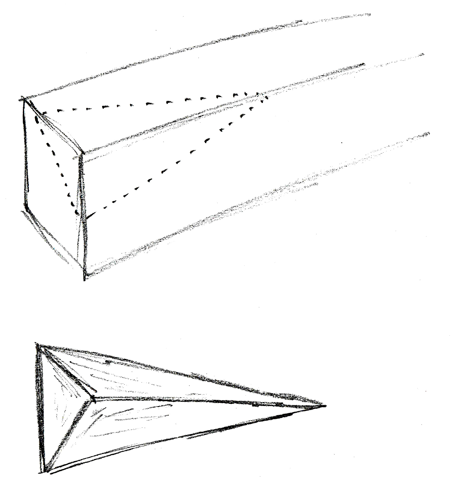

In the modern day, the disposable chopsticks you'll find at many Asian restaurants work perfectly. Just make sure to get the ones with rectangular ends instead of round ones. Very early scribes _did_ use round styli as well^[You'll find some discussion of this [in a later lesson](#numbers).], but "standard" cuneiform was always written with rectangular ones; you won't get crisp, sharp wedges without it!

Unfortunately, this lesson is being displayed on a flat screen, which makes it difficult to show the three-dimensional wedges. Photos don't tend to show them very well, as you can see here^[Specifically, this is a New Script form of the sign _ik_, the third sign on line 15 of the tablet KBo VI.1, part of the _Epic of Gilgamesh_.]:

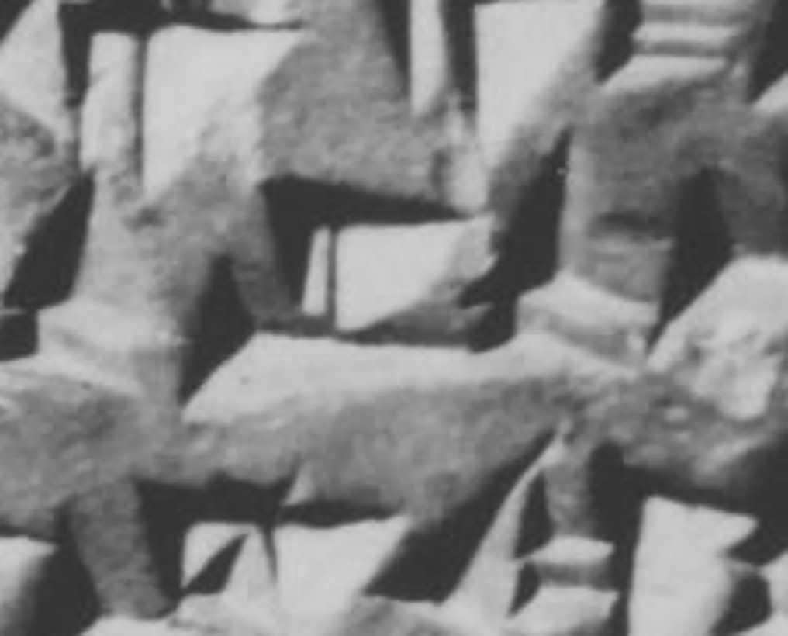

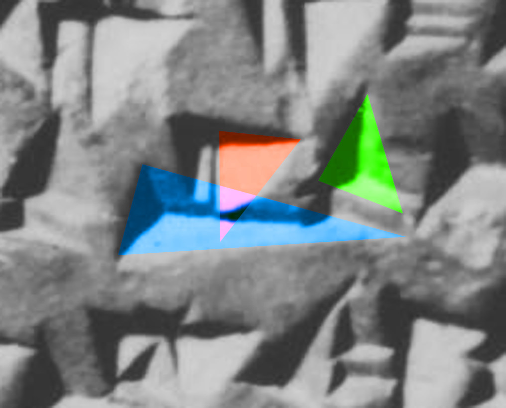{#color-figure}

So for two-dimensional screens and pages, we tend to use drawings ("autographs") instead of photos.

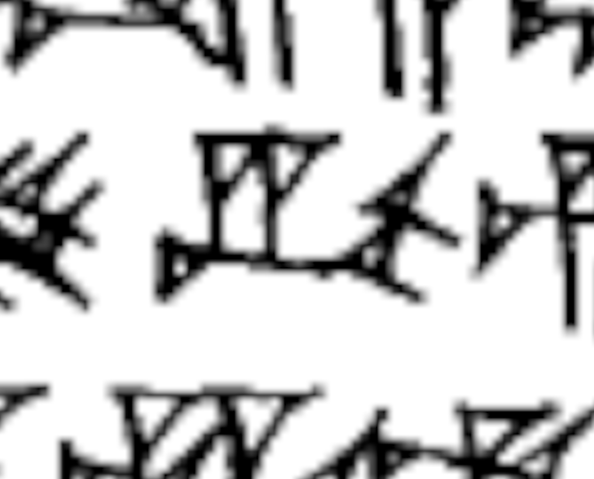

You'll find more details in [lesson 1B](#lesson-1b-strokes-on-paper). But for now, the only thing that's important is to recognize what wedges look like in these drawings.

## Horizontal and vertical

The most common types of strokes are the horizontal and vertical, and they're written with two different edges of the stylus.

) are made with the long edge.](images/stylus_h.jpg)

) are made with the short edge.](images/stylus_v.jpg)

This means that a scribe can switch between them easily, without needing to rotate their wrist ninety degrees every time. It also means that horizontal strokes can be any length, but vertical strokes are limited by the size of the stylus. This led to cuneiform signs all having approximately the same height vertically, but varying widths horizontally, which makes them line up nicely in rows.

In Hittite, the head of a horizontal stroke is always at the left, and the head of a vertical stroke is always at the top. In other words, strokes always point down or to the right, never up or to the left. In some other styles of cuneiform (like Old Babylonian), there are sometimes upward vertical strokes, but never leftward horizontal strokes. An upward vertical just requires tilting your hand a bit more, but a leftward horizontal would require flipping the stylus all the way around!

## Diagonal

The diagonal strokes are less common in Hittite, because they required actually rotating either your hand or the tablet! They're fundamentally the same as the horizontal and vertical strokes you've already seen, just drawn on an angled tablet.

This means that we often find intricate arrangements of horizontals and verticals, and intricate arrangements of diagonals, but usually not arrangements that mix the two of them. It would be a pain to keep rotating the tablet back and forth, so usually all the diagonal strokes in a sign are grouped together.

The only diagonal strokes found in Hittite are the "upward" diagonal, from bottom left to top right, and the "downward" diagonal, from top left to bottom right. Just like with horizontals, diagonals never go from right to left in Hittite use—it would require flipping the stylus all the way around, and that's just too much of a pain.

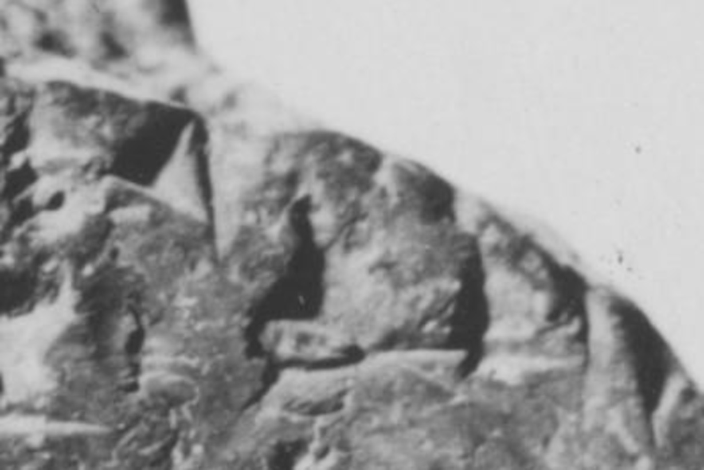

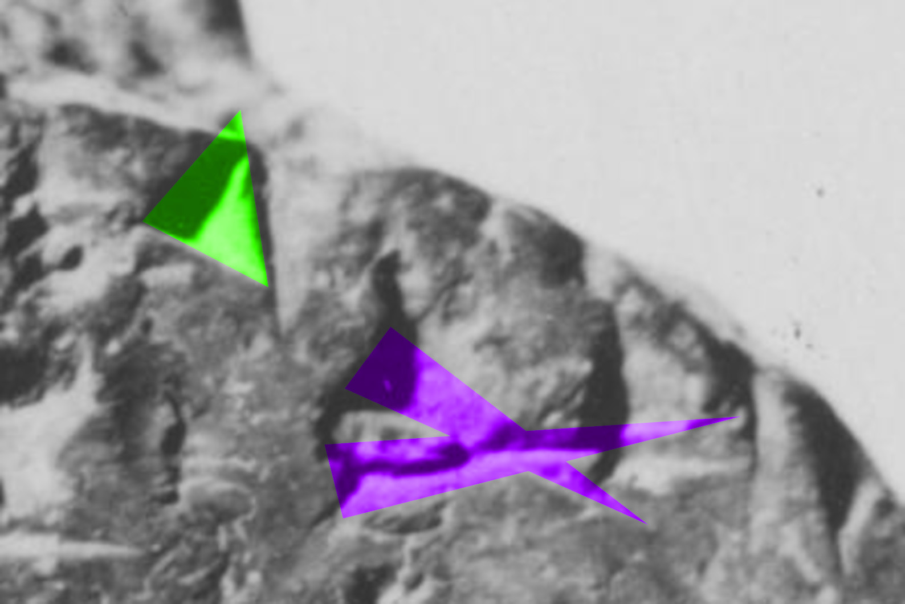

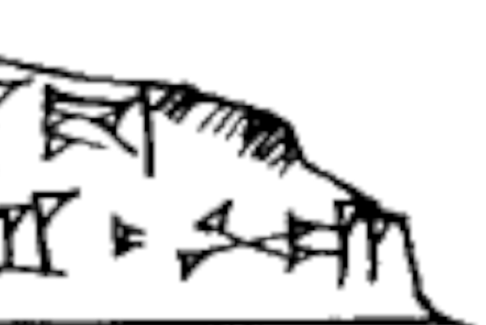

## Winkelhaken

The last type of stroke is the "Winkelhaken", German for "angular hook". (They can also be called "hook" strokes if you want to stick to English.) These look like broad, flat triangles, and are made with the corner of the stylus.

) are made with the corner.](images/stylus_c.jpg)

In some styles of cuneiform, the diagonal strokes were dispensed with, and all signs were made up of horizontals, verticals, and hooks. But in Hittite, you have all five to deal with. If you ever see something that looks like a horizontal with the head on the right, it's actually a horizontal with a hook at its tip.

Sometimes the difference between downward diagonals and hooks isn't entirely clear, so some authors group them together as the same thing. But hooks could be written without rotating the tablet, so they're often written in horizontal rows and vertical columns (like in the sign _ce_), while diagonals required tilting everything, so they're usually stacked together diagonally (like in the sign _hi_).

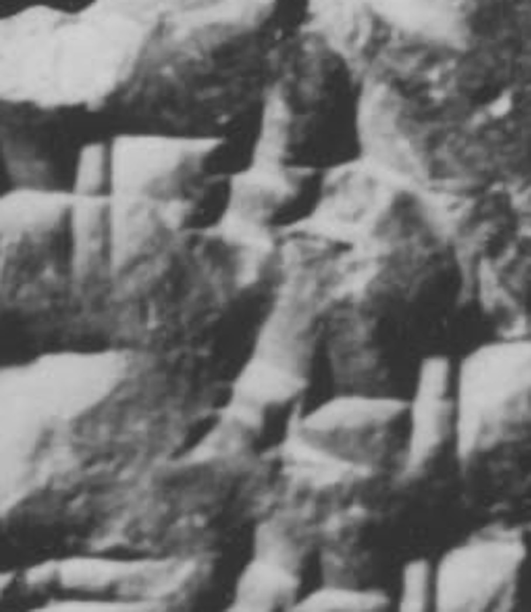

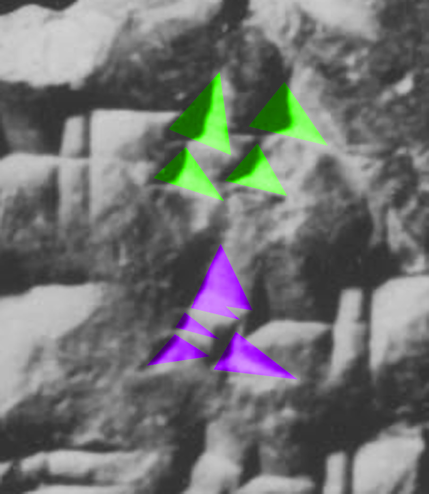

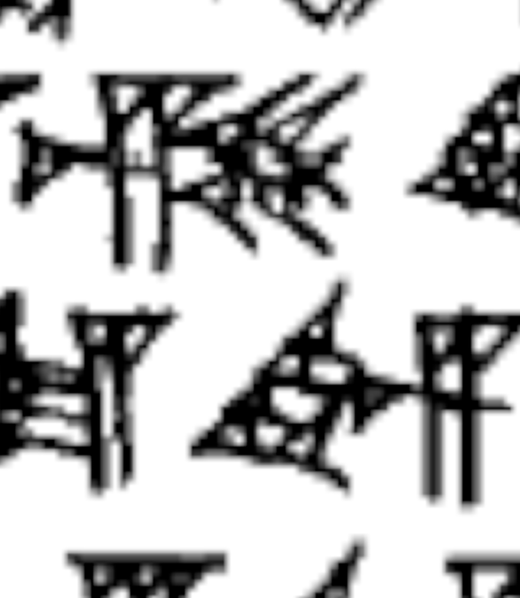

Since this distinction is so hard to see, though, most sign search tools will offer an option for "I don't know if this is a diagonal or a Winkelhaken", or even have that as the default! It matters more for _writing_ tablets than for _reading_ them.

## Exercise 1A

Get some clay (Play-Doh works well for this) and a stylus (disposable chopsticks with rectangular ends are perfect) and practice making the five different types of strokes. Then try to draw these signs:

# Lesson 1B: Strokes on paper

Of course, in the modern day, most of our writing materials are flat. Students are taking notes on flat paper instead of clay, instructional materials are published in flat books, and these pages are being shown to you on a flat screen.

This is a problem, since it makes it very hard to display three-dimensional wedges! Cuneiform doesn't photograph very well; it's easy to see the wedges when you can rotate the tablet in your hand, but a static photo is a different story.

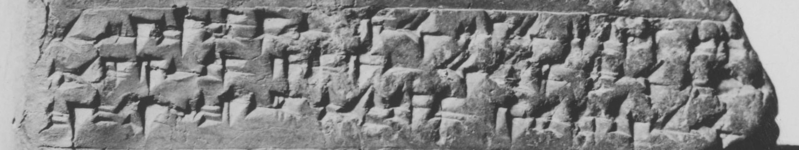

As a result, a lot of different conventions have arisen for how to represent cuneiform on paper and screens. Most modern scholars aren't working with the physical object, or with a photograph; instead, they use "autograph" drawings, and the first step in analyzing a tablet is to make one of these.

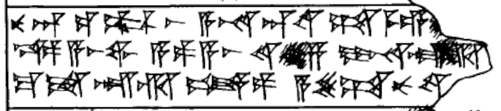

Ideally, an autograph needs to show the position, length, and direction of each stroke, _and_ where the head is. We can't just draw the heads, because these three are different signs (the sounds _qa_, _me_, and _bar_)^[This is specifically the older form of the sign _qa_; the newer form, which you'll be learning in a later lesson, has an extra stroke.]:

But we also can't just draw the tails, because these two are different signs (the number 2 and the sound _a_):

So we need to somehow indicate the heads, _and_ the tails. But there are several different ways of doing that, going all the way back to ancient Mesopotamia!

## Styles of writing

Because while cuneiform was usually stamped into clay, that wasn't always an option. Sometimes an ancient king would want to inscribe their glorious deeds in stone monuments, or paint them on the walls of buildings…or a scribe's tablet dried out before he had time to sign his name.

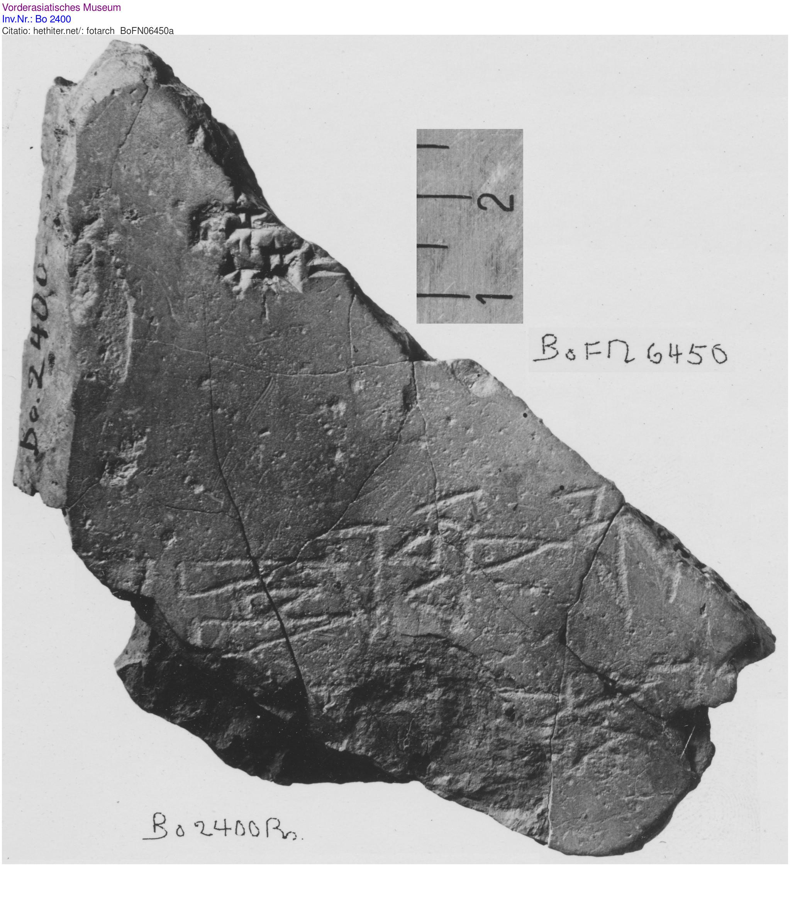

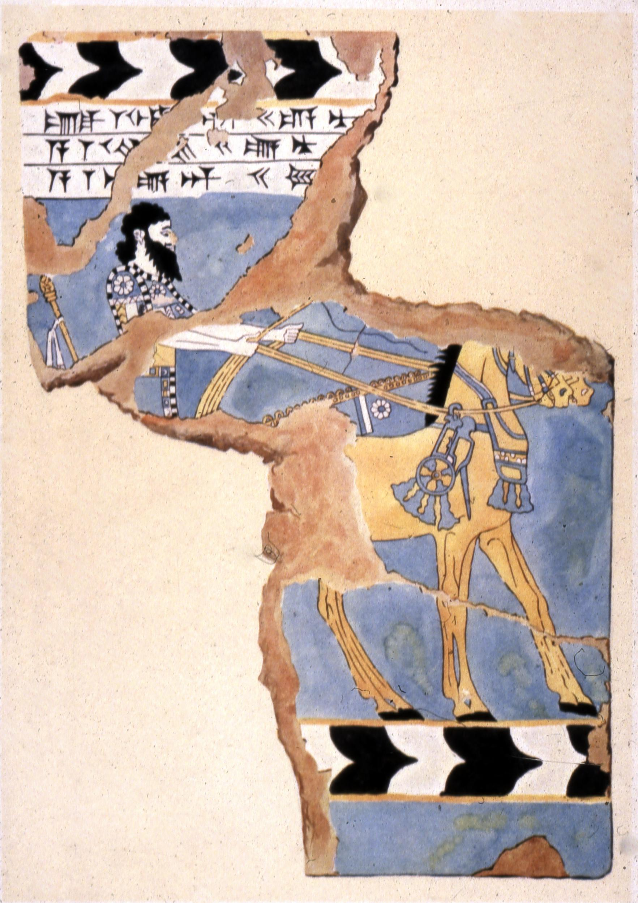

I've written more about these different styles [on my blog](https://namdubsar.tumblr.com/post/751199029039431681/drawing-cuneiform-part-13), if you're interested. But all of them are trying to represent both the head and the tail of the stroke, generally using three or more pen strokes to do it. This is what makes cuneiform signs look so complicated and difficult by modern standards. But it's important to remember that each wedge is only a single press of the stylus—even if it takes three pen lines to draw, each wedge only takes a moment to form on actual clay.

## Assyrian ink

Most of the ancient examples of inked cuneiform are exceptional ones: intricate works of art, or scribes improvising with a fired tablet. But at one point, there may have been a tradition of "casual" inked cuneiform as well.

One of the last of the Assyrian emperors, Ashurbanipal, had tablets collected from across the empire to build an all-encompassing library. Like any good librarian, he wanted the name of the library stamped on every tablet, to make sure they'd get returned properly. (And like any good emperor, he made sure his own name was included in that.)

Generally this was inscribed the usual way, with a stylus. But in some cases, the tablets looted from various conquered cities were already fired. When this happened, the librarians wrote the name of the library on in ink.

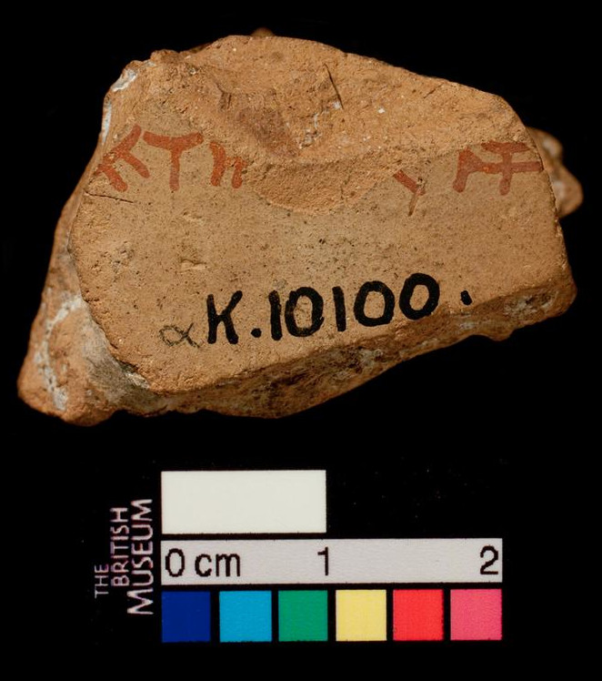

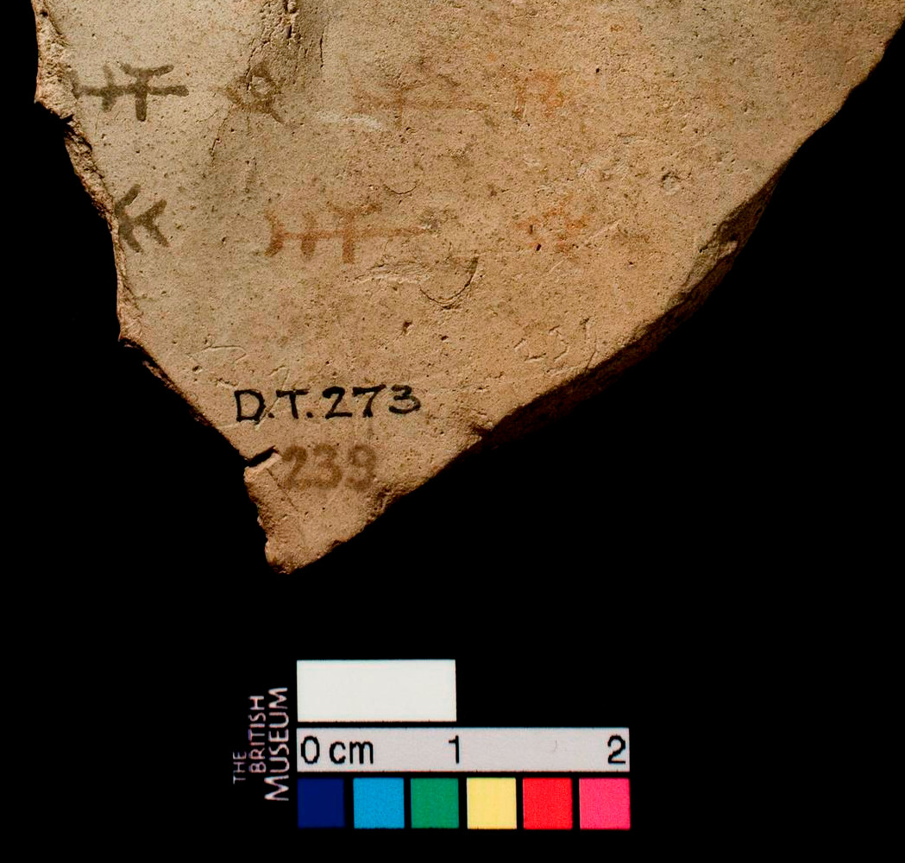

This inking style is only known from three tablets, since ink is a lot less durable than fired clay. But given how cleanly it's written (compared to that Hittite scribe awkwardly scraping out triangles), there was probably a larger tradition around this. The head of the stroke is drawn with a single curved line, and the tail with a single straight line; in my opinion, this ends up being a lot more readable than forms which draw a full triangle for the head.

{#gilgamesh-ink}

This is how the cuneiform in this article is displayed by default. If you don't like this style, you can change it with the dropdown at the top of the page. Just remember that all of these styles are compromises to represent a fundamentally three-dimensional script on a two-dimensional screen; the best way to write cuneiform is always with a stylus on clay!

## Exercise 1B

Take these signs in the Assyrian ink style and draw them on clay^[Again we're looking at an Old Hittite form of _en_ here instead of New Hittite, since it makes a better demonstration.].

Take these signs and draw them in the Assyrian ink style.

# Lesson 1C: Pronunciation

Hittite cuneiform is specifically designed to write _Hittite_, so it can be useful to know a bit about the sounds of Hittite and how they were pronounced. Feel free to [skip this lesson completely](#lesson-2-transliteration-and-v-signs) if you're not interested; you can always come back later if you're wondering how _c_ or _ā_ was pronounced, or why there isn't any _s_.

## Consonants

Hittite cuneiform represents sixteen different consonants: _p b t d k g q m n l r c z h y w_. However, these weren't all actually distinguished in the Hittite language! The signs _ta_ and _da_, for example, are used pretty much interchangeably; choosing one over the other doesn't seem to indicate any difference in pronunciation. Even when writing in Akkadian, a language that _did_ distinguish _t_ from _d_, the Hittite scribes mix them up constantly, suggesting they couldn't hear a difference between them. The same goes for _p_ and _b_, and _k_, _g_, and _q_. In other words, the Hittite language had no voicing distinction^[Or ejective distinction, for that matter. _Q_ in Akkadian is an "emphatic" (probably ejective) velar stop.].

Instead, they distinguish _single_ from _double_ consonants: while there's no distinction between _t_ and _d_, there **is** a distinction between _t_ and _tt_. This holds true for almost all of the consonants^[It seems that _z_ was always "double" and _y_ and _w_ always "single". The rest could be either.]: _apa-_ "that" is a different word from _appa_ "back". The word for "you" appears as _zikka_, _zigga_, and _ziqqa_ interchangeably, even within the same text, but never as \*\*_zika_^[Why not _zikga_, _ziqka_, and so on? You'll learn why in [lesson 5](#lesson-5-vc-signs). The short version is that cuneiform never distinguished voicing at the end of a syllable, so _ik_, _ig_, and _iq_ are written exactly the same way.].

Scholars disagree on how this distinction was actually pronounced^[Some suggest it was a voicing or aspiration distinction, based on Proto-Indo-European etymology and Ugaritic transcriptions, but the consensus seems to be moving toward a length distinction.], but the leading theory is that the doubled consonants had a longer duration than the single ones—_pp_ and _nn_ were pronounced for twice as long as _p_ and _n_, like in "lamp post" versus "compost", or "unnamed" versus "unaimed".

Since there was no distinction between the pairs _t/d_, _p/b_, and _k/g/q_, dictionaries alphabetize them under _t_, _p_, and _k_, respectively. Really, the only reason why _d_, _b_, _g_, and _q_ are used at all is to make transcriptions more legible: we want to indicate the exact signs used to write a word, and _ba_ is just easier to read and write than _pa~2~_. Similarly, _y_ and _w_ are alphabetized as if they were _i_ and _u_, since it's not entirely clear if there was a distinction there, or if _i u_ just become _y w_ before vowels.

## C, Z, and H

Most of the consonants are pronounced about as you'd expect^[The same as their IPA values, for the linguistically-inclined, except that _y_ is IPA /j/.]—we don't know precisely how the Hittites spoke, so an English "d", a Spanish "d", and a Mandarin "d" are equally valid ways to pronounce a Hittite _d_^[As are an English "t", a Spanish "t", and a Mandarin "t", for that matter—remember, there's no difference between _t_ and _d_ in Hittite.]. But three of these consonants are less obvious.

The _c_ sound is written as _š_ in most books, and was probably pronounced like an English /s/, as in "**s**ip"^[In other words, some sort of sibilant fricative, and Egyptian transcriptions suggest an alveolar one.]. Some languages that used cuneiform distinguished _s_ from _c_, with one being the /s/ sound in "**s**ip" and the other the /ʃ/ sound in "**sh**ip" (see [below](#akkadian-phonetics)), but Hittite never did, so both pronunciations are valid and won't create any confusion. Hittite scribes chose to use the _c_ signs to write their sibilant, abandoning the _s_ signs completely, so we transcribe it that way for consistency.

In these lessons, I've used _c_ instead of _š_ simply to make it easier to type, but _š_ is what you'll find in published dictionaries. Some books on Hittite use _s_ instead for simplicity, but that is **not** a good idea if you're doing anything with cuneiform, for reasons [that will be explained in a later lesson](#lesson-8-logograms). Still, Hittite dictionaries alphabetize it under _s_, and it's the best way to transcribe an /s/ sound in foreign names. Some people write it as _sh_ as a compromise, but this creates its own set of problems: how are you going to write the distinction between _c-h_ and _c-c_ (as in _echar eccai_ "she spills blood") without it becoming unreadably messy?

The _z_ sound is a /t͡s/^[Linguistically, it's not clear if it was one phoneme or a sequence of two, since those cuneiform signs are also used when _t_ and _c_ end up next to each other for any reason. But it's convenient to assume it's a single one, since it's written specially, and it can appear where other consonant sequences can't.], as in "pi**zz**a" or "Mo**z**art", or the end of "ca**ts**". Unlike in English (but like in Russian and Japanese: tsar, tsunami), this sound can appear at the beginning of a word in Hittite, as in _zik_ "you". The sequence _tc_ was always written as _z_, so if you like the "ship" pronunciation of _c_, you can pronounce _z_ like the "ch" in "**ch**ur**ch**" for consistency. This is also the best way to transcribe sounds like the aforementioned /t͡ʃ/ in "**ch**ur**ch**" and the /d͡ʒ/ in "**j**ump" in foreign names.

Finally, the _h_ sound^[The most interesting sound for historical linguists, since it's the reflex of Proto-Indo-European \*h~2~, and sometimes \*h~3~.] is some kind of fricative in the back of the mouth. Most scholars pronounce it like the sound in German "a**ch**" or Hebrew "**ch**et" (IPA /x~χ/), though evidence from Ugaritic suggests it might also have been pharyngeal like Arabic "**ḥ**al" (/ħ/) or voiced like Spanish "ami**g**o" (/ɣ/), depending on the environment.

Any of these pronunciations works, as does the /h/ sound in English "**h**at". In formal publications it's generally written _ḫ_, or sometimes _x_^[Though I really don't recommend _x_. It's the IPA symbol for this sound, which is why it's sometimes used in linguistic works, sort of like writing _c_ as "s", since that's how it's pronounced. But in cuneiform transcriptions, lowercase _x_ on its own means "there's a sign here but it's too damaged to read", the times sign × means "this sign is composed of one sign inside another", and the subscript ₓ means "we're confident in this reading but it hasn't been officially acknowledged by a sign list yet". Technically, none of these create ambiguity with using _x_ for a consonant, but it's just asking for trouble. So "s" and "x" are fine if you're **only** talking about the language, but if you're doing anything at all with the cuneiform writing system, use _c_ and _h_ (or _š_ and _ḫ_ in more formal publications) instead.], but using the letter _h_ doesn't cause any problems, since there's no other "H-like" sound in cuneiform to confuse it with. No matter how you choose to pronounce it, make sure it's distinct from _k_, and that you can pronounce it both at the start of a word (_hanti_ "separately") and in the middle of one (_mahhan_ "when")^[It can't appear at the end of a word in Hittite, but it does appear at the end of some Sumerian logograms like MAH "great" too.].

When two consonants appear next to each other in a transcription, they **do not interact** with each other. _Ch_ in Hittite transcriptions is the sound of _c_ followed by the sound of _h_, like in the middle of "gra**ssh**opper". _Echar_ "blood" is pronounced something like "ess-khar" (/es.xar/), not *"eh-char" (/e.tʃar/).

## Labiovelars

Hittite also had two additional sounds which didn't have dedicated signs in cuneiform. These are known as the "labiovelars", and linguists write them as _k^w^_ and _h^w^_, as in _ek^w^zi_ "she drinks" and _tarh^w^en_ "we overpowered"; they were pronounced something like Hittite _k_ and _h_ crossed with _w_. In other words, _k^w^_ is approximately the "qu" in "**qu**een"; _h^w^_ doesn't have a close analogue in English, but if you pronounce "**w**ine" differently from "**wh**ine", the "**wh**ine" sound (/ʍ/) is a fine approximation^[Linguistically, it's a labialized version of _h_, so probably something like /xʷ~χʷ/.].

In cuneiform, _k^w^_ is written as either _ku_ or _uk_, whichever the scribe preferred at the moment, while _h^w^_ is written as either _hu_ or _uh_—and as a result, that's how they tend to be written in our modern transcriptions as well. So outside of specialized linguistic works, these words will be written _ekuzi/eukzi_ and _tarhuen/taruhen_ instead, without the special _^w^_; this is how you'll see them in the later lessons.

## Vowels

Hittite had five vowels, _a_, _e_, _i_, _o_, and _u_. Some scholars don't believe there was a distinction between _o_ and _u_, and as a result, _o_ is always alphabetized as _u_ in dictionaries^[And often written that way, too! Most dictionaries will list _ōp-_ "to rise" as _ūp-_.], but consensus is slowly shifting toward them being distinct. The pronunciation was along the lines of the _a_ in "father", the _e_ in "forte", the _i_ in "machine", the _o_ in "code", and the _u_ in "tuba"—that is, the vowels are spoken the way they're pronounced in most other languages (or in the International Phonetic Alphabet), not the way they're generally pronounced in English^[When we can't even reach a consensus on whether _o_ and _u_ were separate sounds, it's hard to say anything more precise about the pronunciation. Some people prefer to transcribe as /ɛ ɔ/ instead of /e o/, for example, but in my opinion there really isn't enough data to make judgements like that, so I'm defaulting to the symbols that are easier to type—it's like how saying "it's around 98.6" instead of "it's around 100" can make people think you have more precise information than you really do.].

These vowels are sometimes written doubled in cuneiform, just like the consonants. Unlike with the consonants, it's not clear if this actually indicated a difference in pronunciation. It might indicate a longer vowel or some kind of stress, but it could also just help make the writing system less ambiguous, [as you'll see in lesson 4](#plene-spellings). In a few cases it distinguishes one word from another, like _maan_ "if" and _man_ "maybe", but this is rare. Kloekhorst proposes that it indicated a glottal stop, but this isn't widely accepted.

While doubled consonants are written double in transcriptions, doubled vowels usually aren't—the Hittite scribes were less consistent about using them, and they look less aesthetically appealing to English-speakers. Instead, a bar^[Called a "macron", Greek for "long".] is put on top of the vowel if it's written double: _ā_, _ē_, _ī_, _ō_, _ū_ (so _man_ versus _mān_). More detail can be found [in a later section](#plene-spellings).

Sometimes the _a_ vowel is even written **tripled**, in a very small handful of words. Based on a scribal convention in Akkadian, and the etymology of these words, it might be an abbreviation for the sequence _ayya_…or for whatever that sequence turned into later on. [Examples are given below](#tangent-hyperplene-spellings).

## Exercise 1C

Try to pronounce these sentences in Hittite. This comes from a myth about a conflict between the storm god Tarhont and the great serpent Illuyanka. After Tarhont is defeated by the serpent in a fight, he asks his daughter Inara (the goddess of wild animals) for help; she prepares a trap for the serpent, and recruits a mortal named Hopaciya to help her in her plan.

_Nu hōman mekki hantāit._  
She prepared lots of everything.

_Wiyanac palhi, marnuwandac palhi, walhiyac palhi,_  
The container of wine, the container of _marnuwand_, the container of _walhi_,

_nu palhac andan iyada iet._  
she put a lot in all of the containers.

_Nu Inarac Ziggaratti pāit._  
Inara went to the city of Ziggaratta.

_Nu Hōpaciyan antuhcan wemit._  
She met the human Hopaciya.

# Lesson 2: Transliteration and V signs

## Signs and readings

Most cuneiform scholars don't actually use the signs themselves in their publications. Until recently, typesetting actual cuneiform signs was near impossible, and even nowadays it's more difficult than it should be.

Instead, it's standard to give a _transliteration_: writing out the pronunciation of each sign rather than drawing the signs themselves. The sign [i]{.signs} is pronounced _i_, for example, so we represent it simply as _i_. Words are separated by spaces, and signs within a word are separated by hyphens, so [a-i]{.signs} is transliterated as _a-i_.

Each "reading" corresponds to one and only one sign, and sign dictionaries list all the applicable readings, so that everyone can be sure that _i_ specifically means [i]{.signs}. In these lessons, you can also see the appropriate reading for any sign when you hover over it. But there are three difficulties that can trip you up.

First, each reading corresponds to one sign, but one sign can have multiple readings! The sign [ki]{.signs}, for example, can represent either _ki_ or _ke_. The scholar making the transliteration needs to pick and choose the appropriate readings to make sense of the text. This becomes an especially difficult task when [logograms](#lesson-8-logograms) get involved.

Second, sometimes multiple signs can be pronounced the same way. In Akkadian, for example, the signs [u]{.signs} and [u₂]{.signs} are both pronounced _u_. It's important to represent this difference in the transliteration, so that readers know which signs are being talked about—otherwise they'd have to go back to the original tablet to check, which defeats the whole purpose of using a transliteration! So numbers are added to the readings to distinguish them: [u]{.signs} is transcribed as _u_, [u₂]{.signs} as _u~2~_, [u₃]{.signs} as _u~3~_, [u₄]{.signs} as _u~4~_, and so on.

This can sometimes lead to a lot of numbers in a text, so there's a shorthand: an acute accent on a vowel stands for the number 2, and a grave accent stands for the number 3. Since every cuneiform sign used in Hittite has a vowel in it somewhere, this works out nicely. But for numbers higher than 3, there's no choice but to resort to the numbers. In other words, the signs [u ú ù u₄]{.signs} are usually transliterated as _u ú ù u~4~_. 

In Hittite, with only a couple exceptions^[In particular, _ur_ and _úr_, and _cu_ and _cú_, are used interchangeably depending on the scribe's whims.], there's only one sign for each pronunciation. But, these readings have to be unambiguous across _all_ languages that use cuneiform—if there's a passage in Akkadian right in the middle of a Hittite text, for example, it would be confusing to change transliteration systems halfway through! It's the same reason we have to use _c_ instead of _s_ for the Hittite /s/ sound. Across different eras and dialects of Akkadian, for example, two different signs were used for the _pi_ sound; Hittite only uses one for that purpose, but through random historical accident, it's the one that was assigned the reading _pí_ (that is, _pi~2~_). As a result, the reading _pi_ never appears in Hittite, only ever _pí_.

## Bound transcription

Transliteration is separate from _bound transcription_, which just attempts to capture the sounds of a Hittite word in an easy-to-read way. A transliteration of the Hittite word for "water" might be _wa-a-ta-ar_ or _wa-a-tar_, depending on the scribe's preference; a bound transcription would be _wātar_, ignoring the details of sign choice to focus on the actual sound of the Hittite word.

Whether something is a transliteration or a bound transcription should generally be clear from context. 

## Vowels

As a result, the signs for the five vowels of Hittite are these. They're known as the "V" signs for short.

+-------------+-------------+-------------+-------------+-------------+
| A           | E           | I           | O           | U           |
+:===========:+:===========:+:===========:+:===========:+:===========:+
| [a]{.signs} | [e]{.signs} | [i]{.signs} | [o]{.signs} | [ú]{.signs} |
+-------------+-------------+-------------+-------------+-------------+

Note again that the /u/ sound is always written with the sign _ú_! The sign that took the reading _u_ is used in Hittite for /o/.

The reason for this confusing state of affairs goes back to the origins of cuneiform. Originally, cuneiform signs were used for entire words: [a]{.signs} meant "water", which was pronounced as _a_ in Sumerian; [u]{.signs} meant "ten" and [ú]{.signs} meant "crops", both of which were pronounced as _u_^[Long ago, "ten" may have actually been _yu_, but by the Akkadian period they were well and truly identical.].

Eventually, these signs were repurposed for their pronunciations instead of their meaning, like how English-speakers sometimes write the word "too" with the symbol for the number "2". And as a result, when the Akkadians adapted the writing system from the Sumerians, they ended up with two separate signs for the _u_ sound, and used them more-or-less interchangeably.

When the Hittites adapted the writing system from the Akkadians, this worked out great for them—because Hittite, unlike Akkadian, had an _o_ sound separate from _u_! So they used [u]{.signs} for the _o_ sound, and [ú]{.signs} for the _u_ sound. But since the sign readings have to be consistent across Hittite, Akkadian, _and_ Sumerian (as well as Hurrian, Hattic, Elamite, and others), we have to transliterate them as _o_ and _ú_, for consistency. Even if [o]{.signs} is never used for the /u/ sound in Hittite, the name _u_ is still assigned to it from Akkadian, and isn't available for [ú]{.signs}.

The five vowel signs are some of the most common in all of Hittite. They're used whenever a vowel makes its own syllable with no consonants around it, like in the word _au_ "look!": [a-ú]{.signs}. But they can also be used in "plene" spellings, which you'll discover [in a later lesson](#lesson-4-cv-signs-part-2). Make sure you learn them well!

## Exercise 2

Practice writing the five vowel signs, ideally on clay as well as on paper.

Adjust the style settings at the top of the page until the signs below are comfortable for you to read, since you're about to encounter a _lot_ more of them!

[a e i o ú]{.signs}

Memorize these five signs, in whatever way works best for you. (Personally, I use [Anki](https://apps.ankiweb.net/) flashcard decks.) You're about to encounter a _lot_ more of them, and you'll want to have a good framework for it.

# Lesson 3: CV signs, part 1

Cuneiform is a _syllabic_ writing system. Unlike an alphabet, it doesn't have a sign for each individual sound. Instead, a cuneiform sign represents a _syllable_, or sometimes a piece of a syllable.

In particular, a cuneiform sign can represent a vowel on its own, but not a consonant on its own—after all, a vowel on its own is a valid syllable, but a consonant on its own isn't. So there are signs for _ta_, _te_, _ti_, and _tu_, but no sign for just _t_; you can't have a _t_ on its own without a vowel attached.

You've already learned the V signs, for vowels with no consonants attached. The next category is the most common one, the _CV_ signs, for "consonant-vowel"—that is, each of these signs represents a consonant followed by a vowel. While English-speakers would spell "banana" as _b-a-n-a-n-a_, Hittite-speakers would write it with only three signs, _ba-na-na_.

+---+--------------+--------------+--------------+-------+------+
|   | A            | E            | I            | O     | U    |
+:=:+:============:+:============:+:============:+:=====:+:====:+
| B | [ba]{.signs} |                             |              |
+---+--------------+ [bi]{.signs}                | [bu]{.signs} |
| P | [pa]{.signs} |                             |              |
+---+--------------+-----------------------------+--------------+
| D | [da]{.signs} | [di]{.signs}                | [du]{.signs} |
+---+--------------+--------------+--------------+--------------+
| T | [ta]{.signs} | [te]{.signs} | [ti]{.signs} | [tu]{.signs} |
+---+--------------+--------------+--------------+--------------+
| G | [ga]{.signs} | [gi]{.signs}                | [gu]{.signs} |
+---+--------------+-----------------------------+--------------+
| K | [ka]{.signs} | [ki]{.signs}                | [ku]{.signs} |
+---+--------------+-----------------------------+--------------+

When one box spans multiple rows or columns, that means the same sign is used for all of those syllables. The signs _di_, _gi_, and _ki_ also have the readings _de_, _ge_, and _ke_^[Sumerian reliably distinguished the vowel _i_ from _e_, but early Akkadian did not, and the Hittite scribes adapted their cuneiform from Akkadian, not Sumerian.]. The sign _bu_ also has the reading _pu_.

The sign _bi_ also has the readings _bé_, _pí_, and _pé_—the signs with the unaccented readings _be_, _pi_, and _pe_ are used for totally different things in Hittite, but just like with _o_ and _ú_, the readings need to be unambiguous across **all** cuneiform-using languages. So you'll only ever use _bé_, _pí_, and _pé_ in Hittite, never _be_, _pi_, or _pe_.

Except for the V signs, no signs in Hittite ever distinguish _o_ from _u_—which is another reason why dictionaries alphabetize them together. If it's important to distinguish them, you'll learn how to do that [in the next section](#plene-spellings). But as a result, nobody's really put in the effort to assign readings like _do_ and _ko_ to those signs; in sign lists, you'll find that _bu_ also has the reading _pu_, but not _bo_ or _po_.

In Sumerian and Akkadian, there was a difference between the sounds of _b_ and _p_, _d_ and _t_, and _g_ and _k_. But the Hittite language didn't have this distinction, and in fact, evidence suggests the Hittite scribes couldn't even hear it in Akkadian—they constantly mess it up when writing Akkadian words! So in Hittite, the difference between (e.g.) _pa_ and _ba_ just came down to personal and aesthetic preference; generally, _ba_ was used in names and titles like _Tabarna_ (the title of the earliest Hittite kings), and _pa_ was used everywhere else. Soimilarly, the sign _gu_ was only used _once_ across all surviving Hittite texts; everywhere else, _ku_ was used instead. When you're writing non-Hittite words (like your own name), of course, it's often a useful distinction to be able to make.

The Akkadian language [also had](#akkadian-phonetics) a consonant _q_ separate from _k_. Hittite didn't, but the sign _qa_ [qa]{.signs} is extremely simple to draw, so Hittite scribes occasionally used it in place of _ka_, giving it the reading _ka~4~_. It's still usually transliterated as _qa_ in Hittite texts for simplicity, even though Hittite had no distinct _q_. Later in these lessons, you'll come across the word for "you" (_zik**ka**_) written with [ka]{.signs}, [ga]{.signs}, and [qa]{.signs} interchangeably; if we wanted to be pedantic, we could use the readings _ka_, _kà_, and _ka~4~_, to show that they all indicate the same sound, but _ka_, _ga_, and _qa_ are easier to type and easier to recognize at a glance.

With these syllables under our belt, we can start spelling some more Hittite words, like _pedi_ "to the place" [pé-di]{.signs}. I'd recommend practicing and learning these ones before moving on.

## Spacing and punctuation

Unlike many other cuneiform-users, the Hittite scribes were generally very precise in laying out their tablets—to the point that the Hittite style of writing is sometimes known as "typewriter cuneiform". Words are never broken across lines, sections are marked out with "rulings" across the full length or width of the tablet, and a bit of space is left between words. This might not sound revolutionary by modern standards, but none of these were standard features of ancient writing systems!

The Hittites even had what might be history's first punctuation mark, the "Glossenkeil" ("gloss wedge"), [:]{.signs}. Since the Hittites [recorded foreign words in their tablets](#tangent-f-and-v) much more often than other cuneiform-users, they used this sign to mark them, sort of like modern italics.

Apart from the Glossenkeil, cuneiform was unpunctuated. But since practically every Hittite sentence ended with a verb, separating sentences wasn't much of an issue.

## Tangent: Hurrian vowels

_**Note:** This section is about languages other than Hittite, so if you're only interested in Hittite, feel free to [skip ahead](#exercise-3)._

For the Hurrian language, scribes went a step further in simplifying the system. Like Hittite, the Hurrian language didn't have any distinction between _b/p_, _d/t_, and _g/k_—so they repurposed these signs to make the vowels less ambiguous instead! In Hurrian, [ge]{.signs} is used for _ke_, [ki]{.signs} is used for _ki_, [ku]{.signs} is used for _ko_, and [gu]{.signs} is used for _ku_. They dispensed with the signs [ba]{.signs}, [da]{.signs}, [ga]{.signs}, [di]{.signs}, and [tu]{.signs} entirely, but brought back [be]{.signs} for _pe_, which wasn't used like this in Hittite.

So for the Hurrian language, we end up with this table instead:

+-----+--------------+--------------+--------------+--------------+--------------+
|     | A            | E            | I            | O            | U            |
+:===:+:============:+:============:+:============:+:============:+:============:+
| B/P | [pa]{.signs} | [be]{.signs} | [bi]{.signs} | [bu]{.signs}                |
+-----+--------------+--------------+--------------+-----------------------------+
| D/T | [ta]{.signs} | [te]{.signs} | [ti]{.signs} | [du]{.signs}                |
+-----+--------------+--------------+--------------+--------------+--------------+
| G/K | [ka]{.signs} | [ge]{.signs} | [ki]{.signs} | [ku]{.signs} | [gu]{.signs} |
+-----+--------------+--------------+--------------+--------------+--------------+

This fits the sounds of Hurrian (and Hittite!) significantly better, but tradition is a powerful force, so this simplified inventory was never consistently adopted for Hittite. And since Hurrian is a lot less studied than Hittite, Hurrian scholars just use the Hittite readings for the signs instead of assigning their own.

## Exercise 3

How would you write these words in bound transcription?

- [e-ku-zi]{.signs} "she drinks"
- [pa-ti]{.signs} "to the foot"

How would you write these words in cuneiform?

- _apata_ "therefore"
- _aku_ "she should die"

Memorize these first 18 CV signs, and make sure whatever method you used to learn the V signs scales up well. There are plenty more signs to come, and it's important to space them out so they don't get overwhelming.

# Lesson 4: CV signs, part 2

Now that you're used to the idea of CV signs, it's time to present the rest of them.

+---+--------------+--------------+--------------+---------------+-------------+
|   | A            | E            | I            | O             | U           |
+:=:+:============:+:============:+:============:+:=============:+:===========:+
| M | [ma]{.signs} | [me]{.signs} | [mi]{.signs} | [mu]{.signs}                |
+---+--------------+--------------+--------------+-----------------------------+
| N | [na]{.signs} | [ne]{.signs} | [ni]{.signs} | [nu]{.signs}                |
+---+--------------+--------------+--------------+-----------------------------+
| R | [ra]{.signs} | [ri]{.signs}                | [ru]{.signs}                |
+---+--------------+-----------------------------+-----------------------------+
| L | [la]{.signs} | [li]{.signs}                | [lu]{.signs}                |
+---+--------------+--------------+--------------+-----------------------------+
| C | [ca]{.signs} | [ce]{.signs} | [ci]{.signs} | [cu / cú]{.signs}           |
+---+--------------+--------------+--------------+-----------------------------+
| Z | [za]{.signs} | [zé]{.signs} | [zi]{.signs} | [zu]{.signs}                |
+---+--------------+--------------+--------------+-----------------------------+
| H | [ha]{.signs} | [hé]{.signs} | [hi]{.signs} | [hu]{.signs}                |
+---+--------------+--------------+--------------+-----------------------------+

The signs _cu_ and _cú_ are used more or less interchangeably. (If you're wondering what _c_ means, check the section on [pronunciation](#lesson-1c-pronunciation) for details.)

_Ri_ and _li_ also have readings _re_ and _le_.

_Ze_ and _he_, without the accents, are alternate readings for _zi_ and _hi_. _Zé_ and _hé_, **with** the accents, are distinct signs (shown in the table). I recommend using the accented ones; they're less ambiguous.

_Mi_ and _ni_ have the less-common alternate readings _mé_ and _né_. But since there were unambiguous signs for _me_ and _ne_ already, those saw more use.

## Plene spellings

Even so, though, many of these signs are ambiguous—when we see the sign [le]{.signs}, how do we know if that's a _li_ or a _le_? To solve this, Hittite scribes would often use "plene" spellings (Latin for "full"): the V signs indicate every vowel unambiguously, so adding an extra V sign will always make things clear. The word for "don't", for example, is always written [le-e]{.signs}, which makes it clear that it's not _li_.

This is one reason to use a plene spelling, but not the only one—we often find plene spellings with the vowel _a_, for example, which can never be ambiguous. Since we're not sure how exactly to interpret them, these spellings are marked with a horizontal line^[Called a "macron". See [lesson 1C](#vowels) for details.] above them in [bound transcription](#bound-transcription): [le]{.signs} in bound transcription is _le_, while [le-e]{.signs} is _lē_. But this may or may not have actually indicated a difference in pronunciation.

Now we can write a few more Hittite words: [ha-pí]{.signs} _hapi_ "to the river", [a-ri]{.signs} _ari_ "to a friend", [ka-a-ca]{.signs} _kāca_ "behold". But we're going to need a new type of sign to spell longer words. So once you're comfortable with these signs, move on to the next section to complete the Hittite syllabary.

## Tangent: Hyperplene spellings

_**Note:** This is an odd curiosity of the writing system that very rarely comes up. Feel free to [skip it](#exercise-4)._

In a very small number of words, we see what's known as a _hyperplene_ spelling, where the same V sign (it's always [a]{.signs}, without exception) is written twice in a row. For example, the verb "to be hot"^[Kloekhorst derives it from PIE \*_h₁eh₃i-_, but I don't know of any other evidence for a root like that.] has forms like [a-a-ri]{.signs}.

In some dialects of Akkadian, there was a convention of using [a-a]{.signs} to write the sequence _ayya_, as in [da-a-a-nu]{.signs} for _dayyānu_ "judge". And since this particular verb also has forms like _aitat_ "it was hot", it's possible that there was a _yy_ between the vowels here too. (It couldn't have been a single _y_, because _aya_ got contracted to _a_ in the prehistory of Hittite.)

As a result, some authors treat this combination as a new sign with the reading _ayya_, and transcribe [a-a-ri]{.signs} as _ayya-ri_. But others disagree, and say it just shows there were multiple syllables there, without proving anything about what might have been between them, with the transcription _a-a-ri_. Given how few words show these hyperplene spellings, it's possible we'll never know. But personally, I like the _ayya_ interpretation.

## Exercise 4

How would you write these words in bound transcription?

- [ka-a]{.signs} "here"
- [a-pa-ci-la]{.signs} "personally"
- [pu-o-ti]{.signs} "to the salt"

How would you write these words in cuneiform?

- _lōri_ "disgrace"
- _ceni_ "to the model"
- _mūlili_ "the _mulili_ plant"

Take as much time as you need to learn these signs before moving on. There are a lot of them!

# Lesson 5: VC signs

With the V and CV signs mastered, you can now write any _open syllables_: syllables that end with vowels. This works great for a language like Japanese or Māori, where almost all syllables are open.

But Hittite, like English, has a lot of _closed syllables_, which end with consonants. To handle these, we need a new set of signs: the _VC_ signs, for vowels followed by consonants.

+-----+--------------+--------------+--------------+---------------+-------------+
| VC  | A            | E            | I            | O             | U           |
+:===:+:============:+:============:+:============:+:=============:+:===========:+
| B/P | [ap]{.signs} | [ip]{.signs}                | [up]{.signs}                |
+-----+--------------+-----------------------------+-----------------------------+
| D/T | [at]{.signs} | [it]{.signs}                | [ut]{.signs}                |
+-----+--------------+-----------------------------+-----------------------------+
| G/K | [ak]{.signs} | [ik]{.signs}                | [uk]{.signs}                |
+-----+--------------+-----------------------------+-----------------------------+
| M   | [am]{.signs} | [im]{.signs}                | [um]{.signs}                |
+-----+--------------+--------------+--------------+-----------------------------+
| N   | [an]{.signs} | [en]{.signs} | [in]{.signs} | [un]{.signs}                |
+-----+--------------+--------------+--------------+-----------------------------+
| R   | [ar]{.signs} | [ir]{.signs}                | [ur / úr]{.signs}           |
+-----+--------------+--------------+--------------+-----------------------------+
| L   | [al]{.signs} | [el]{.signs} | [il]{.signs} | [ul]{.signs}                |
+-----+--------------+--------------+--------------+-----------------------------+
| C   | [ac]{.signs} | [ec]{.signs} | [ic]{.signs} | [uc]{.signs}                |
+-----+--------------+--------------+--------------+-----------------------------+
| Z   | [az]{.signs} | [iz]{.signs}                | [uz]{.signs}                |
+-----+--------------+-----------------------------+-----------------------------+
| H   | [ah]{.signs}                                                             |
+-----+--------------------------------------------------------------------------+

The VC signs distinguish fewer consonants than the CV signs: _b/p_, _d/t_, and _g/k_ have to share their signs. This doesn't cause a problem in Hittite, which never distinguished those consonants anyway—though it is quite annoying in Akkadian, where this difference is important!^[In Akkadian it's even worse, since the "emphatic" consonants also aren't distinguished at the end of a syllable: _ak_ is also _ag_ and _aq_, _it_ is also _id_ and _iṭ_, _us_ is also _uz_ and _uṣ_, and so on. As far as I know, nobody in the Akkadian world ever found a solution for this. But this is actually how [iz]{.signs} gets the reading _iz_: it started as a [logogram](#lesson-8-logograms) for "wood", and the Akkadian word for "wood" is _**iṣ**um_.] Every single one of those signs has alternate readings—_ap_ is also known as _ab_, _uk_ is also known as _ug_, and so on—so that we can write transliterations like _at-ta_ and _ad-da_, which just look better than _ad-ta_ and _at-da_. But no matter how we transliterate them, **no** sign in cuneiform ever distinguishes _b/p_, _d/t_, or _g/k/q_ at the end of a syllable. This is a universal rule going back to Sumerian^[In Sumerian, the "voiceless" consonants were originally aspirated, and stops at the end of a word were unreleased, so the aspiration distinction disappeared.].

The signs _ip_, _it_, _ik_, _im_, _ir_, and _iz_ also have readings _ep_, _et_, _ek_, _em_, _er_, and _ez_.

The sign _ah_ also has readings _eh_, _ih_, and _uh_, but not _oh_. As above, _o_ gets left out for the simple reason that nobody's been interested in going through and adding _o_ readings to the sign list. But if you use one of these at the start of a word, it's a good idea to use a plene spelling to show what vowel you mean!

Like _cu_ and _cú_, _ur_ and _úr_ are used more-or-less interchangeably.

## Writing closed syllables

Equipped with our new list of VC signs, we can now write words like _appa_ [ap-pa]{.signs} "back" or _eczi_ [ec-zi]{.signs} "is". But what do we do when a syllable has a consonant at the start _and_ at the end? How can we write _per_ "house" with these signs?

The solution is to combine CV and VC signs with the same vowel. To write _per_, we use [pé-er]{.signs}. Even though the vowel gets written twice, this is _not_ considered a plene spelling; it's just the standard way of representing these syllables, so we don't use a macron in bound transcription. If we _did_ want to use a plene spelling—say, to write the word _cēr_ "above"—we would add an additional V sign, [ce-e-er]{.signs}.

Equipped with these, we can now write more elaborate Hittite words, like _antuhcac_ [an-tu-uh-ca-ac]{.signs} "person", or _haccucari_ [ha-ac-cu-ca-ri]{.signs} "to the queen".

This system works great for Akkadian, which never allows more than one consonant at the start or end of a syllable. But Hittite, like English, allows more. How can we use this system to write a word like _harkzi_, "has"?

The usual solution is to use additional VC signs! To write the syllable _hark-_, we use one CV sign for the consonant at the start, and two VC signs for the consonants at the end, [ha-ar-ak]{.signs}. The _a_ vowel of the third sign is considered an _empty_ vowel: there's no actual vowel there in the Hittite word, it's just required by the constraints of the writing system.

Sometimes Hittite scribes would repeat the previous vowel in these VC signs, sometimes they'd use the vowel _a_ regardless of what came before, and sometimes they'd use CV signs instead, like [ha-ra-ak]{.signs}. For example, _linkta_ "she swore an oath" can be _li-in-ik-ta_, _li-in-ak-ta_, or _li-in-ka-ta_^[As far as I know, the first of these is the only one attested for this particular form, but we see all of them across various verbs and forms. That's the problem with having relatively little text to work from!]. Since this problem never came up in Akkadian, there was no standard precedent to follow, and individual scribes (or maybe scribal schools?) came up with their own solutions. But whichever you choose, I recommend always using the VC signs for this instead of the CV ones: if you write _hark_ as [ha-ra-ak]{.signs}, how will you write _harak_?

## CV/VC ambiguity

Now that we have both CV and VC signs to work with, sometimes there are multiple ways to write the same word. When writing the word _apac_ "that", should it be [a-pa-ac]{.signs}, or [ap-ac]{.signs}?

The answer is [a-pa-ac]{.signs}. Even though it takes three signs instead of two, ancient scribes almost always spelled it this way.

Why use the extra sign? The choice actually gives us some insight into how the Hittite language worked! It seems that in Hittite, when there was a single consonant between two vowels, it acted as the start of the second syllable, not the end of the first syllable. In other words, _apac_ was pronounced as _a-pac_, not as _ap-ac_.

As a result, whenever there's an ambiguity like this, you should **use the CV signs instead of the VC ones**, even if it's longer. This way, the breaks between syllables line up with the breaks between signs—and it lets us use the VC signs to indicate multiple consonants at the end of a syllable, [as we saw above](#writing-closed-syllables).

This is something the Hittite scribes were generally quite consistent about, and they make sign breaks line up with syllable breaks as much as possible. The only exception to this rule was—rarely—when there was an obvious break between the parts of a word^[That is, the morphemes and/or clitics.]; in this case, they sometimes prioritized _those_ breaks instead. For example, the word _ēcer_ "they were" breaks down into _ēc-_ "be" and _-er_ "they"; it's usually written [e-ce-er]{.signs}, but can also (rarely) be written [e-ec-er]{.signs}.

## Exercise 5

Write the following words in cuneiform.

- _harcan_ "head"
- _icpanza_ "night"
- _canhti_ "you search"

Write the following words in bound transcription.

- [ha-al-ki-ic]{.signs} "grain"
- [ec-ha-ar]{.signs} "blood"
- [ka-ar-ap-zi]{.signs} "she lifts"

Start memorizing the VC signs. This is the largest batch you need to memorize in this course; it's all downhill from here.

# Lesson 6: The last few signs

This set of signs is _almost_ sufficient to represent every syllable in Hittite. But there are two consonants missing: _y_ and _w_. These sounds are rare to nonexistent in Akkadian, so when the Hittites adapted the writing system, they didn't have much material to work with here.

## Y

For _y_, there's a special sign _ya_, which is just _i_ and _a_ smashed together: [ya]{.signs}. There are no signs for _y_ in any other combination—that is, no signs for _ye_, _yu_, _ay_, and so on. _Yi_ probably wasn't possible at all.

This is partially because these combinations were much rarer than _ya_. But when they did have to write a word like _yugan_ "yoke", they would use the _i_ sign: [i-ú-ga-an]{.signs}. Even in the case of _ya_, it was occasionally written with an extra _i_ for good measure: the serpent Illuyanka, who you've seen in some of the examples, is alternately called [il-lu-ya-an-ka]{.signs} and [il-lu-i-ya-an-ka]{.signs}. As a result, some scholars question whether there was a difference between _y_ and _iy_ at all.

+---+--------------+
|   | A            |
+:=:+:============:+
| Y | [ya]{.signs} |
+---+--------------+

## W

_W_ is rare to nonexistent in Akkadian, depending on the dialect, but even more common than _y_ in Hittite. So the Hittites had to get creative for this one.

Some older dialects of Akkadian have a sign for _wa_, [wa]{.signs}, which the Hittites used extensively. This sign is better-known to Akkadian scholars as _pi_, which is how the later, _w_-less dialects of Akkadian used it; this is the reason why Hittite only uses _pí_ for that syllable. (Remember, the sign names have to be unambiguous across _all_ languages that use cuneiform, not just Hittite!)

In addition, the Hittites repurposed the [logogram](#lesson-8-logograms) ŊECTIN [ŊECTIN]{.signs}, which means "wine". Their word for "wine" was _wiyanac_, so they used this sign for the syllable _wi_, giving it the reading _wi~5~_.

For _w_ in front of any other vowel, they'd use the sign _ú_ (or less often _o_). The word _welluc_ "meadow", for example, would be written [ú-el-lu-uc]{.signs}. _Wu_ and _wo_ might not have been possible at all. Since _wi~5~_ took a while to catch on, you'll also not infrequently find [ú-i]{.signs} for _wi_. Just like with _iy_, we sometimes see _uw_, and there may not be any difference between that and normal _w_.

+---+--------------+---------------+
|   | A            | I             |
+:=:+:============:+:=============:+
| W | [wa]{.signs} | [wi₅]{.signs} |
+---+--------------+---------------+

## cp-

[You've seen](#writing-closed-syllables) now how to write multiple consonants at the end of a syllable. But what about multiple consonants at the beginning?

Well, the prevailing view is that it just didn't happen in Hittite. There are a lot of words that start with the combinations _icp-_, _ict-_, and _ick-_, always written with an _i_ rather than any other vowel, which suggests that Hittite did something similar to Spanish: if there were multiple consonants at the start of a word, add a vowel in front to break them up. (That's why we see Spanish _**e**scuela_ from Latin _schola_ "school", _**e**spada_ from Latin _spatha_ "sword", and so on.)

However, there are a few times when these words are written with _ci-_ instead of _ic-_: the word _icpanti_ "she sacrifices" is usually [ic-pa-an-ti]{.signs}, but is sometimes [ci-pa-an-ti]{.signs} instead. Some scholars take this as evidence that there wasn't really an _i_ there at all, and the word should really be read as _cpanti_^[If this is the case, though, it's not clear why they'd consistently use an _iX_ sign, because multiple consonants at the end of a syllable generally use _aX_ or repeat the vowel.].

When writing names with multiple consonants at the beginning, I recommend inserting an _i_ at the beginning; it's likely that the ancient Hittites would pronounce an extra vowel at the start of "Steven" just like modern Spanish-speakers do. If your name really _does_ start with a sequence like _isk-_, you can use a [plene spelling](#plene-spellings) to make it clear.

## A brief example

Using these signs, we can write even more Hittite and non-Hittite names. For example, Wiluca [wi₅-lu-ca]{.signs} was a city-state in ancient Anatolia. One king of Wiluca, Alakcandu [a-la-ak-ca-an-du]{.signs}, made a treaty with the Hittite emperor Murcili II [mu-ur-ci-li]{.signs}, invoking the patron god of the city, Āppaliona [a-ap-pa-li-o-na]{.signs}. In the treaty, Murcili claimed that Wiluca and the Hittites had been on good terms for centuries. Later in his reign, though, Murcili needed to reassert control over Wiluca by force—the exact circumstances aren't clear, but one theory is that Alakcandu was overthrown by a faction more sympathetic to the foreign state of Āhhiyawa [a-ah-hi-ya-wa]{.signs}.

It's hard to be sure from the very fragmentary documents we have, but it's possible that we're seeing here a contemporary account of the Trojan War! Wiluca could be Wilion (another Greek name for Troy, hence the "**Ili**ad"), Āhhiyawa could have been the Achaeans (that is, the Mycenaean Greeks), Alakcandu could have been Alexander of Troy (better known as Paris), and Āppaliona could have been Apollo, the divine defender of the Trojans.

If you look for these names online, you'll more often see them transcribed as Wilusa, Alaksandu, Mursili, Appaliuna, and Ahhiyawa. In other words, _c_ is usually transcribed as _s_. This conveys the pronunciation better when talking about the Hittite language, but it's very important to write _c_ (or the fancier _š_) instead of _s_ when you're talking about cuneiform, [for reasons you'll see in a later lesson](#lesson-8-logograms). Just remember to change it to an _s_ when you're searching.

## Tangent: F and V

_**Note:** This section is not important for writing Hittite. If you're only interested in Hittite, feel free to skip down to [the next one](#exercise-6)._

And that's all the sounds of Hittite! But unlike Sumerian and Akkadian scribes, Hittite scribes also cared a lot about representing the sounds of other languages as accurately as they could. The Hittites called themselves "The People of a Thousand Gods", and they tried to adopt the deities of conquered peoples into their pantheon whenever possible. And with those adopted gods came adopted prayers and rituals—if you want a Hurrian god to respond, then obviously (at least to a Hittite priest) you need to pray in Hurrian. Otherwise, how will the god understand you?

They weren't always successful in recording these sounds. For example, [they couldn't tell apart the voiced and voiceless sounds of Akkadian](#consonants), so incantations in Akkadian are filled with confusion between _t_ and _d_, _p_ and _b_, and so on^[These incantations are marked _Babilili_—"in the language of Babylon"—but they usually wrote it _**p**a-bi-li-li_.]. But they did recognize that Hurrian and Hattic had a sound that didn't line up with any of their cuneiform signs, and invented some new signs to represent it.

These new signs consist of _wa_ with the vowel signs _a_, _e_, _i_, _o_, _ú_ written under the horizontal stroke: [wa+a we+e wi+i wu+u wu+ú]{.signs}. (Scholars disagree on whether _o_ and _ú_ represented different vowels in Hittite, but they definitely did in Hurrian.) Since these signs were never used to write Hittite words, the sound must have been something different from the Hittite _w_; the leading theory is that it was a labial fricative, something like the English /f/ or /v/. Since we're still not sure quite what sound this was, these signs are most often transcribed as _wa~a~_, _we~e~_, and so on, or as _wa~4~_, _wé_, _wí_, _wú_, _wù_—but I also assign them the readings _fa_, _fe_, _fi_, _fo_, and _fu_. Even if the sound wasn't the same as the English "f", after all, we know that it _wasn't_ a Hittite /w/, and it makes things more readable to assign it its own letter instead of repurposing _w_ or adding even more subscripts.

So while these signs aren't needed for actual Hittite words, they can be useful for writing foreign names (like yours!). Hurrian seems to have had the same length distinction as Hittite^[That is, distinguishing between _tt_ and _t_ rather than between _t_ and _d_.], so to make a long _f_, they would use the _p_ signs: _affa_ would be [af-fa]{.signs}, _uffe_ [uf-fe]{.signs}, and so on. Hurrian scholars generally give these signs the readings _áw_, _éw_, _íw_, _úw_ (for transcriptions like _awwa_ and _uwwe_), since Hurrian didn't have the Hittite _w_. But I prefer the readings _af_, _ef_, _if_, _uf_, for the same reason that we don't write the Hittite _c_ as _s_—it's cleaner not to change transcription systems in the middle of a text.

+---+--------------+--------------+--------------+--------------+--------------+
|   | A            | E            | I            | O            | U            |
+:=:+:============:+:============:+:============:+:============:+:============:+
| F | [fa]{.signs} | [fe]{.signs} | [fi]{.signs} | [fo]{.signs} | [fu]{.signs} |
+---+--------------+--------------+--------------+--------------+--------------+

For example, the name of one of the (many!) Hittite sun gods was borrowed from Hattic: [fu-ru-un-ce-mu]{.signs}. This is usually transcribed as _Wuruncemu_, but I prefer the transcription _Furuncemu_.

Four additional signs combine _wa_ with _ap_, _ip_, _pí_, and _pu_: [wa+ap wi+ip wi+pí wu+pu]{.signs}. It's not clear what sounds these were supposed to represent, so they don't have standard readings assigned, but it probably involved _f_ in some way. They could be something like \*_áf_, \*_íf_, \*_fí_, and \*_fú_, but it's not clear why the scribes would invent both [fi]{.signs} and [wi+pí]{.signs}, or [fu]{.signs} and [wu+pu]{.signs}, and they were perfectly happy to use [ap]{.signs} for _af_ (and so on). So what exactly these signs meant is an open question in Hittitology, and I haven't attempted to give them any fancy names myself.

## Exercise 6

Learn the Y and W signs (and the F signs, if you like), and start practicing all the V, CV, and VC signs together. You won't need to memorize any more signs in this course—the rest can all be looked up as you need them—but it's vital to have at least a basic memory of all the V, CV, and VC signs, since they make up the vast majority of any Hittite text.

Now that you have them, though, it's time to start working with some actual Hittite documents! Remember [the story of Illuyanka](#exercise-1c)? Make a bound transcription for these lines, where the goddess Inara has made her proposition to the human Hopaciya.

[ki-ic-ca-an hu-o-pa-ci-ya-ac i-na-ri]{.signs}  
Hopaciya spoke thus to Inara:

[ma-a-wa ka-at-ti-ti ce-ec-mi nu-wa ú-wa-mi]{.signs}  
"If I can sleep with you, I will come."

Convert these sentences into cuneiform. The equals signs mark the boundaries between _clitics_, where multiple units are combined into a single word—like how "men's" is a single word in English, but it's made up of "men" and "'s". You can ignore them when writing your cuneiform: in cuneiform, _n=ac_ and _nac_ are written exactly the same.

_"Kardiac=tac iyami."_  
"I will fulfill your wish."

_N=ac katti=ci cecta._  
So she slept with him.

I've modified the cuneiform for these examples slightly, to avoid using any signs from later lessons^[For example, there really should be some [determiners](#determiners).], but the Hittite words are the same. You'll find the full, unadulterated Hittite text in [the final test](#final-test).

# Lesson 7: CVC signs

In addition to the V, CV, and VC signs, Hittite had a limited selection of _CVC_ signs, representing a vowel with a consonant both before _and_ after it^[In the original Sumerian cuneiform, most signs were actually CVC signs: _an_ was originally _ʔan_, _ba_ was originally _baʔ_, and _a_ was originally _ʔay_. But even within Sumerian these quickly got simplified to the readings we're now familiar with.]. Unlike the others, these signs weren't strictly necessary: the word _wātar_ "water" could be written [wa-a-tar]{.signs}, with a CVC sign _tar_, but it could just as well be written [wa-a-ta-ar]{.signs}, with a CV sign _ta_ and a VC sign _ar_. It's a tradeoff between efficiency and complexity: [tar]{.signs} is much shorter than [ta-ar]{.signs}, but it also means a new group of signs to learn.

If there was a unique sign for every CVC combination in the language, that would require at least 520 signs—more than there were in the entire Hittite writing system! So many of these signs had multiple readings, and many possible CVC combinations had no signs for them at all. Scribes tended to use these signs however they pleased to make words shorter, with some scribes using lots and others using none at all. You can learn them if you like, or stick to CV-VC pairs and [skip to the next section](#two-special-cases). Just don't be surprised if you come across them in a text.

:::{.smaller}
+-------+-----------------------------------------------------------------------------------------------+
| CVC   Signs                                                                                           |
+:=====:+:==============================================================================================+
| H     | [hal hap har hac hat hul hup hur]{.signs}                                                     |
+-------+-----------------------------------------------------------------------------------------------+
| G/K   | [gal kal kam kán kap kar kac kat gaz kip kir kic kit₉ kul gul kum kur gur]{.signs}            |
+-------+-----------------------------------------------------------------------------------------------+
| L     | [lal lam lik lic luh lum]{.signs}                                                             |
+-------+-----------------------------------------------------------------------------------------------+
| M     | [mah man mar mac mec mic mur]{.signs}                                                         |
+-------+-----------------------------------------------------------------------------------------------+
| N     | [nam nap nir níc]{.signs}                                                                     |
+-------+-----------------------------------------------------------------------------------------------+
| B/P   | [pal bar pac pát píl pir pic pít pur pùc]{.signs}                                             |
+-------+-----------------------------------------------------------------------------------------------+
| R     | [rat ric]{.signs}                                                                             |
+-------+-----------------------------------------------------------------------------------------------+
| C     | [cah cak cal cam càm cap car cìp cir cum cur]{.signs}                                         |
+-------+-----------------------------------------------------------------------------------------------+
| D/T   | [tah dak tal dam tan tap tar tác tàc tén tim tin dir tir dic tíc túh túl tum tup dur]{.signs} |
+-------+-----------------------------------------------------------------------------------------------+
| Z     | [zul zum]{.signs}                                                                             |
+-------+-----------------------------------------------------------------------------------------------+
:::

No cuneiform signs ever distinguished _b/p_, _d/t_, or _g/k/q_ at the end of the syllable, so every sign like _hap_, **without exception**, also has a reading _hab_. Since Hittite didn't distinguish those consonants in general, most signs like _kam_ also have readings like _gam_; I haven't listed those here to save space, but you can find them in a dictionary.

## Two special cases

However, there are two words in Hittite that are _exclusively_ written with CVC signs. It's important to know these ones even if you ignore all the rest, because these meanings are almost never written with CV-VC pairs.

The "emphatic particle" _=pat_ can be attached to the end of any word to emphasize it, sort of like an underline (or rather an underline that can be read out loud). This word is always written with the CVC sign [pát]{.signs} rather than [pa-at]{.signs}. In Akkadian, that sign also has the reading _be_, but in Hittite, [bé]{.signs} (_bé_) is used for that instead. There's historically been some confusion over how this sign should be read—since the particle is always written this way, how do we know which way it's supposed to be pronounced? So you'll find older works transcribing it as _be_ or _pít_; nowadays, though, seeing it used as a CVC sign in other words has led to a consensus on _pát_. For example, the goddess Hepat is sometimes [hé-pát]{.signs} and sometimes [hé-ba-at]{.signs}^[Remember, there's no difference between _b_ and _p_ in either Hurrian or Hittite. It would be more accurate to transcribe the longer version as _hé-pá-at_, but _ba_ is easier to type and easier to read, so it persists.].

The "sentence particle" _=kan_ is attached to the first word of a sentence to alter the meaning of the verb in hard-to-predict ways. It's one of the most common words in Hittite, especially in later eras where it started replacing all the other "sentence particles", but also one of the hardest to translate. Like _=pat_, it's always written with the CVC sign [kán]{.signs} rather than [ka-an]{.signs}, but unlike _=pat_, there's never been much confusion over how to pronounce this one.

Apart from these, I'm not aware of any word in Hittite that's exclusively written with CVC signs. You're welcome to stick to V, CV, and VC signs for all the rest; while _wātar_ "water" is usually written [wa-a-tar]{.signs}, it's perfectly valid to write it [wa-a-ta-ar]{.signs} if you're not pressed for space.

## Exercise 7

Write the following words in two different ways each.

- _marri_ "very"
- _kiccan_ "thus"
- _aggātar_ "death, ruin"

You don't need to memorize the CVC signs; there are plenty of them that even I don't have memorized, and just look up when I need them. But if you want to work with actual Hittite texts, make sure you learn [pát]{.signs} and [kán]{.signs}, since they're by far the most common.

# Lesson 8: Logograms

The approximately 100 signs you've learned in the V, CV, and VC categories are enough to write the pronunciation of any word in Hittite. It just might take a lot of them! To write _antuwahhac_ "person", for example, it takes six: [an-tu-wa-ah-ha-ac]{.signs}.

But back in Sumerian times, cuneiform started as a _logographic_ writing system. Like in Chinese, every sign originally represented a specific _word_, before they were repurposed to write specific _sounds_. So when an Akkadian or Hittite scribe wanted to shorten a word, they could bring back one of the old Sumerian logograms ("word signs"). Instead of spelling out _antuwahhac_ with those six phonetic signs, you could write the single logogram that means "person", [LÚ]{.signs}. Much shorter!

There are about 300 different logograms that we find in Hittite texts, though most of them are extremely rare. It's likely that scribes looked up the rarer ones when they needed them rather than memorizing them all, and that there were more logograms in their dictionaries that weren't used in any surviving texts.

I encourage modern students to do the same: when you come across a sign you don't recognize, learn to look it up rather than trying to memorize them all. But a handful of logograms are extremely common—common enough, in some cases, that we're not sure how the Hittite word was pronounced, since it was never written phonetically! A sample of those are included here.

Since we don't always know how these logograms were pronounced in Hittite, we transcribe them with their original Sumerian names, in ALL CAPS to show that they're not actually read that way. Many signs can be used either phonetically or logographically, so it's important to pay attention to the difference: the sign [A]{.signs} might be the phonetic sign _a_, or the logogram A, meaning "water". The Sumerian word for "water" was pronounced _a_, which is why this sign was used for this pronunciation in the first place, but in Hittite, it needs to be read as _wātar_.

(Instead of "logograms", these signs are sometimes called "Sumerograms", because they're taken from the Sumerian language.)

## Sumerian phonetics

Since logograms are transliterated with their Sumerian names, we do need to know a little bit about Sumerian phonetics. For the most part, we see exactly the same consonants in Sumerian as in Hittite, which isn't a coincidence: since the cuneiform writing system was originally designed for Sumerian, the Sumerian inventory was the raw material the Hittite scribes had to work with^[The story is actually a bit more complicated than that: additional signs were adapted for the _q_, _ṭ_, _ṣ_, and _ʔ_ sounds of Akkadian, for example, which the Hittites could have used. But overall, they didn't.].

But Sumerian also had at least three more sounds that Hittite lacked. First and foremost, it had an _s_ sound distinct from _c_. While Hittite never had separate signs _si_ and _ci_, Sumerian very much did—and both of those signs are used as logograms in Hittite! Since SI [SI]{.signs} "horn" and CI [CI]{.signs} "eye" are different signs, we need to keep their transliterations distinct, and _this_ is why we've been using _c_ in our Hittite transcriptions all this time. Having SI refer to [SI]{.signs} but _si_ refer to [ci]{.signs} would just be too confusing. It's fine to use the letter "s" when talking about the Hittite language in general, or Hittite names and words in a non-cuneiform context, but if you're doing anything with cuneiform transcriptions, it's vitally important to keep your _c_ (or _š_) separate from your _s_.

The second sound is the "ng" at the end of the English word "si**ng**", and is transcribed as _Ŋ/ŋ_ (a cross between "n" and "g") in these lessons. For ease of typing, you can also represent it as _j_, which looks vaguely similar and wasn't being used for anything else; you'll also find it written as _ĝ_ or _g̃_ in some dictionaries. Unlike in English, this sound can appear at the beginning of a word as well as the middle or end: ŊIC [ŊIC]{.signs} "wood", DIŊIR [DIŊIR]{.signs} "god", SAŊ [SAŊ]{.signs} "head".

However, most of our knowledge of these Sumerian pronunciations comes from bilingual dictionaries written by Akkadian-speaking scribes. And just like how Hittite-speaking scribes struggled to tell the difference between _t_ and _d_, Akkadian-speaking scribes struggled with the distinction between _ŋ_ and _g_, writing it as _ng_ between vowels and _g_ anywhere else. As a result, you'll usually find those signs written as GIC, DINGIR, and SAG instead, unless the author is really interested in accurate Sumerian pronunciation^[Which, well, I am.]. For Hittite purposes, it's not a problem to spell them that way instead.

The last additional sound is usually transcribed as _dr_, since that's how the Akkadian-speaking scribes recorded it. We're not entirely sure how it was pronounced^[The leading theory is an aspirated version of _z_, something like /ts^h^/.], but Sumerian scholars believe it turned into a _r_ in some dialects and a _d_ in some others, so _dr_ is a convenient approximation, as in GUDR [GUDR]{.signs} "cow". Specialized books on Sumerian sometimes write it as _ř_, as in GUŘ, but I've never seen this done for Akkadian or Hittite texts, so I'm sticking to _dr_.

It's possible that Sumerian had a few additional sounds^[Jagersma suggests IPA /j/, /h/, and /ʔ/.], but none of them were represented in the bilingual dictionaries, so we don't use them in transliteration.

## Common logograms

This table gives some of the most common logograms in Hittite. There are hundreds more, though; an important part of reading cuneiform is being able to look up new logograms in a dictionary when you need them.

+-----------------+---------------+-----------------+------------------+------------------+
| People          | Places        | Roles           | Offerings        | Other            |
+:===============:+:=============:+:===============:+:================:+:================:+
| [LÚ]{.signs}    | [KUR]{.signs} | [LUGAL]{.signs} | [ŊECTIN]{.signs} | [EŊIR]{.signs}   |
+-----------------+---------------+-----------------+------------------+------------------+
| “man”           | “land"        | “king”          | “wine”           | “back”           |
+-----------------+---------------+-----------------+------------------+------------------+
| [MUNUS]{.signs} | [URU]{.signs} | [DUMU]{.signs}  | [UDU]{.signs}    | [SISKUR]{.signs} |
+-----------------+---------------+-----------------+------------------+------------------+
| “woman”         | “city"        | “child”         | “sheep”          | “ritual”         |
+-----------------+---------------+-----------------+------------------+------------------+
| [DIŊIR]{.signs} | [É]{.signs}   | [DAM]{.signs}   | [GUDR]{.signs}   | [UD]{.signs}     |
+-----------------+---------------+-----------------+------------------+------------------+
| “deity”         | “building"    | “wife”          | “cow”            | “day, sun”       |
+-----------------+---------------+-----------------+------------------+------------------+

For many of these we know the Hittite pronunciations. The Hittite word for "god" is _ciuc_, for example, "king" is _haccuc_, and "land" is _utnē_. But for many we don't, because the word is only ever written with a logogram! We can only guess at the Hittite words for "woman" and "son", for example.

[UD]{.signs} is by convention transcribed UD when it means "day" and UTU when it means "sun"^[It also has the value _u~4~_, for kind of an odd reason. In Akkadian, the word for "day" is _umum_, and this is usually written with a [phonetic complement](#phonetic-complements) as UD-_mum_. As a result, to make their transcriptions cleaner, some Assyriologists like to write this as U~4~-_mu-um_ instead of UD-_mu-um_. I'm not sure why this is done specifically for "day"; the word _ilum_ "god" is usually written DIŊIR-_lum_, but nobody is giving DIŊIR the reading I~x~.], but this ends up being more of a guideline than a hard rule. Many people split the difference and go with UT, which is how it's used syllabically even if it doesn't quite match either of the Sumerian words; just make sure you don't mix it up with UDU ([UDU]{.signs}) or URU ([URU]{.signs})!

## Inflection

This system hits a snag when it comes to inflection. In Hittite, words are modified in various ways to indicate their role in a sentence: the word for "person" is _antuwahhac_ if it's the subject of the sentence, _antuwahhan_ if it's the object, _antuwahhi_ if it's the recipient, _antuwahhec_ if there's more than one person, and so on. When you write the Sumerogram [LÚ]{.signs}, how do you know which of these it means?

To some extent, they could work around this problem with more logograms. Sumerian didn't usually mark if nouns were singular or plural^[Though they'd sometimes repeat a logogram, so we occasionally see [KUR.KUR]{.signs} for "lands" and such in Hittite texts.], but the word [MEC]{.signs} meant "they are", so it was only used with plural nouns. So, Hittite scribes borrowed it as a plural marker, using [LÚ]{.signs} to mean "person" and [LÚ.MEC]{.signs} to mean "people". Originally there was a convention to use [MEC]{.signs} ("they are") for people and [HI.A]{.signs} ("mixed") for objects, but over time, both of these were applied freely to all sorts of nouns. In transliteration, multiple signs making up a single logogram are separated by dots, so this would be transliterated as LÚ.MEC or LÚ.HI.A.

Unfortunately, Sumerian didn't have any convenient words that could be repurposed for "subject of a sentence" and so on. The easiest solution, then, was to write the last sign or two of the Hittite word after the logogram—_antuwahhac_ is [LÚ-ac]{.signs}, _antuwahhan_ is [LÚ-an]{.signs}, and _antuwahhi_ is [LÚ-hi]{.signs}.

The same went for verbs: _icpanthi_ "sacrifice" could be written with the five signs [ic-pa-an-at-hi]{.signs} or the single sign [BAL]{.signs}. But to distinguish between _icpanthi_ "I sacrifice", _icpanti_ "she sacrifices", _icpantanzi_ "they sacrifice", and so on, these could be written [BAL-hi]{.signs}, [BAL-ti]{.signs}, [BAL-an-zi]{.signs}. If you're used to Japanese, this is very similar to how Japanese-speakers combine kana and kanji!

## Phonetic complements

Writing the last sign of a word like this is called a _phonetic complement_, and it's useful for more than just inflection. For example, Sumerian only had a single word for "back", EŊIR. But Hittite has two: _appa_ for "backward" and _appan_ for "behind". Phonetic complements can be used to tell them apart: [EŊIR-pa]{.signs} means _appa_, and [EŊIR-an]{.signs} means _appan_!

It also offers us a little bit of information about the Hittite word, even when we don't know the whole thing. We're not sure quite how "woman" and "son" were pronounced, for example, but they're sometimes written with complements like [MUNUS-za]{.signs} and [DUMU-ac]{.signs}, so we know they end in _-za_ and _-ac_. This can be a big help when we're trying to figure out the words! With a whole lot of this sort of detective work, for example, Melchert figured out that the word for "son" had to start with a vowel and end with _-lac_, and proposed that the mysterious term _ayawalac_ found in one particular letter is actually the missing word for "son". Similarly, Güterbock analyzes the various different phonetic complements used with [MUNUS]{.signs} and compares them against words in other languages to propose the reading *_kuwanza_^[The star in front means this word is never actually attested anywhere, just reconstructed by linguists.].

## Numbers

One of the most popular uses for logograms, across all sorts of languages and cultures, is for numbers. It's just so much more convenient to write "69,105" than to spell out "sixty-nine thousand, one hundred five", especially when you're filling out tables or doing accounting. Part of why the cuneiform writing system developed in the first place was for accounting and tax purposes, so it's no surprise that they've got a well-developed number system as well!

This system went through a lot of different changes over the millennia it was used, but this is how the Hittite version works.

Number signs in Hittite are made up of two components: vertical strokes, and hook/diagonal strokes. A vertical stroke represents 1, and a hook or diagonal represents 10.

:::{.figure}
[1 2 3 4 5 6 7 8 9 10]{.signs}  
Signs for 1 through 10.
:::

:::{.figure}
[10 20 30 40 50]{.signs}  
Signs for 10 through 50.
:::

These symbols can be combined to write larger numbers. "29", for example, would be [20-9]{.signs}.

This system works as you'd expect up to 59. But 60 is _not_ written with six hooks—it's written with a single vertical again!

:::{.figure}
[60 70 80 90]{.signs}  
Signs for 60 through 90.
:::

Originally (back in the Sumerian days), 1 was a narrow stroke and 60 was a wide stroke, written with two different round styli^[10 and 600 were then written by stamping the end of the round styli into the clay to make differently-sized circular impressions.]. But when scribes started using a single rectangular stylus to write, this turned into the world's first place value system! Just like how the digit "1" for us can mean 1, 10, 100, or 1,000, depending where it appears in the number, a single vertical stroke can mean 1, 60, or even 3,600. So the number 86 would be written as [80-6]{.signs}: one vertical for 60, two hooks for 20, and six verticals for 6.

Since the Sumerians had no zero, the sign [60]{.signs} was generally not used on its own in Hittite—it was just too ambiguous. To write the number 60 in isolation, the Hittites borrowed the Akkadian word [_ŠU-ŠI_]{.signs}.

Like all logograms, these signs do have fancy Sumerian names (DIC for 1, MIN for 2, EC~5~ for 3…), but it's more common just to write their values^[Some older sources like to write these values in Roman numerals, like XVII instead of 16. The meaning is the same.]. Since some of them look very similar to other signs—for example, [10]{.signs} (10) looks identical to [o]{.signs} (_o_), and [90]{.signs} (90) looks very similar to [MEC]{.signs} (MEC)—the Hittites also had a special logogram, [KAM]{.signs}, meaning "number". This makes it clear^[In earlier styles of writing, MEC and 90 were truly identical. It's only in later Neo-Hittite script that MEC started to be written with horizontals instead of hooks.] that [UD.MEC]{.signs} is UD.MEC "days (plural)", while [UD.90.KAM]{.signs} is UD.90.KAM "ninety days".

While the Hittites definitely had words for the numbers, these logograms were so convenient that their pronunciation is almost never written out. We only know how 3 and 7 were pronounced because they were used to spell other words: the drinks _teriyallac_ and _siptamiyac_ are sometimes written as 3-_yallac_ and 7-_iyac_, suggesting that those two are pronounced _teri-_ and _siptam-_. Scholars have made guesses at the others, but they're approximate at best—some people think 1 was _anzac_, for example, while others say _ciac_.

## Tangent: Larger numbers

_**Note:** Like the other tangents, this section is entirely optional. Feel free to [skip ahead](#exercise-8) if you're not interested in mathematics._

In Babylonian cuneiform, you could use the place value system for numbers as large or as small as you want—the "1" sign could also mean 1/60 or 1/3600, extending the place value system to the right just like we do with our modern decimal point. But the Hittite scribes had no need for this kind of fancy mathematics, and their own number words were based on tens, not sixties. So they adopted separate logograms for "hundred", "thousand", "ten thousand", and "hundred thousand"^[I'm simplifying somewhat here: we don't actually see the single sign _LIM_ used for "thousand" on any Hittite tablet. Instead, they spelled out the [Akkadogram](#akkadograms) _LI-IM_. But the progression is clear enough, we have very few attestations of numbers this large, and the _LIM_ sign is frequently used for that pronunciation in other Akkadograms, so I don't think this it's unreasonable to extrapolate that _LIM_ on its own could also be used this way. Similarly, the sign for "hundred thousand" is reconstructed only, but we can reasonably speculate that it was originally a single sign for the reasons given below.].

:::{.figure}
[100 1000 10000 100000]{.signs}  
Signs for 100, 1,000, 10,000, and 100,000.
:::

[100]{.signs} is just the sign _me_, short for _meʔatu_, the Akkadian word for "hundred". [1000]{.signs} is a straightforward combination of 10 and 100, which thus took on the reading _lim_ in Akkadian; _līmu_ is the Akkadian word for "clan" or "tribe", and the title for "leader of a clan" was repurposed to mean specifically "commander of a thousand soldiers". The fact that it looks the same as [ci]{.signs} (the syllable _ci_ or a logogram for "eye") is sheer coincidence.

[10000]{.signs}, then, is [1000]{.signs} with some extra strokes added; in Akkadian, this is called a _gunû_ sign, from the Sumerian for "decorated". It's once again coincidence that it looks the same as the logogram SIG~7~ "yellow-green". But we don't know how this one was pronounced in Sumerian, Akkadian, _or_ Hittite^[Though phonetic complements suggest the Hittite word ended with an _-a_!], so 10000 or SIG~7~ is as good a name as we're going to get.

There's no sign for 100,000 in Akkadian or Sumerian. It's just not a number that ever comes up in everyday life; for advanced mathematics, the Babylonians could use their place-value system, and to express a vague big number^[Like how an English-speaker might say "it feels like a million degrees out".], they'd use 3,600 (that is, 60 times 60—it's not a coincidence that this is the number of seconds in an hour!). But there's exactly one Hittite text where this number is expressed, and it was **probably** expressed with the sign [100000]{.signs}—that is, 10000 with even more extra strokes.

I say "probably" because this text was composed in the Old Hittite period, but the only version that survives is a later copy, and the later scribe clearly didn't recognize this sign. He replaced it with the sequence [GACAN-*TI*]{.signs}. The logogram GACAN means "lady", and the Akkadian word for "lady" is _bēlti_, so the scribe presumably read this as a logogram with an Akkadian phonetic complement. But in context, the word "lady" makes no sense whatsoever.

The relevant line reads^[Well, almost. As mentioned above, I modified the Akkadogram _LI-IM_ to _LIM_ here for simplicity, since Akkadograms aren't covered until lesson 10. The same goes for the other texts in this section, which similarly used _LI-IM_ in the original.] [9-an 1000 9-an 10000-an 9-an 100000 MU.HI.A-uc]{.signs}: "nine thousands, nine ten-thousands, nine hundred-thousands years [may the gods grant to the king and queen]." So this seems to be how the Hittites wrote out larger numbers: a single digit (1 through 9) followed by a logogram for the order of magnitude. These signs don't seem to be used alone; for something like "one hundred" they write [1 1000]{.signs} instead of just [1000]{.signs}. And they aren't always written from smallest to largest; we also have lines like [1 10000 5 1000 5 100 NAM.RA.MEC]{.signs} "one ten-thousand, five thousand, five hundred captives".

These numbers are extremely rare; generally, if a Hittite scribe wanted to express a vague big number, they'd use "1,000" (for example, the Hittite pantheon is known as [1 1000 DIŊIR.MEC]{.signs}, "The Thousand Gods"), and there's very little other need for numbers higher than 99. As a result, most people name these logograms ME, LIM, SIG~7~, and GAŠAN+TI, based on the signs they look like. But I've tentatively assigned them the names "100", "1000", "10000", and "100000", for easier reading. Thus, we can transcribe the line above as "9-_an_ 1000 9-_an_ 10000-_an_ 9-_an_ 100000 MU.HI.A-_uc_", without having to resort to the logogram names for "yellow-green" and "lady".

As a final note on this topic, the number "1,000" seems to have had special importance to the Hattic people who predated the Hittites. The Hattic word for "thousand" is written as [fa-ar]{.signs} (remember [the _fa_ sign](#tangent-f-and-v)?), and it appears in the Hattic word for "pantheon", [ta-fa-ar-wa-ac-ha-ap]{.signs}. It may also be in the middle of the Old Hittite royal title _Ta**bar**na_, which could have meant something like "the ruler of a thousand" (that is, "everyone").

## Exercise 8

You don't have to memorize all the logograms in the Hittite language—that would be a monumental task! If you do more work with Hittite, you'll start to recognize the most common ones, but for all the rest, even experts in cuneiform have to consult a dictionary from time to time. [You'll find some options in the "further reading" section.](#further-reading)

Here are five Hittite words, written both phonetically and logographically, but in scrambled order. Transcribe the pronunciation of each word, and match the pronunciations to their meanings.

- [KUR.KUR-e]{.signs}
- [ci-uc]{.signs}
- [pi-ir]{.signs}
- [DIŊIR-uc]{.signs}
- [wi₅-ya-an-ac]{.signs}
- [ci-wa-at-ta]{.signs}
- [É-ir]{.signs}
- [ut-ne]{.signs}
- [ŊECTIN-ac]{.signs}
- [UD.3.KAM-at-ta]{.signs}

# Lesson 9: Determiners

Unfortunately, Sumerian logograms were extremely ambiguous. The [pa]{.signs} sign started as a picture of a branch (_pa_ in Sumerian) with some twigs coming off it. But it was also used to write the Sumerian words _ŋidru_ "staff" (since a staff looks pretty similar to a branch) and _ugula_ "overseer" (it's easier to draw a staff than a person who wields one). Sometimes the difference between a staff and an overseer is important—so how do you indicate which is which?

The solution was to add a _determiner_^[The linguistics term is _semagrams_, "meaning signs". But this is practically never used in Assyriology.]: an extra sign indicating what general sort of thing you're talking about. An overseer is a person, so it's written [LÚ^UGULA]{.signs}; a staff is made of wood, so it's written [ŊIC^ŊIDRU]{.signs}. In transliteration, determiners are generally written in superscript: ^LÚ^UGULA, ^ŊIC^ŊIDRU. When typing, you can use a caret instead: LÚ^UGULA, ŊIC^ŊIDRU.

These determiners proved useful enough that they started being used with Akkadian and Hittite words, too. They can be a useful clue to what a word means, and there are various Hittite words whose meanings are _only_ known through their determiners: we aren't sure what exactly an _urāc_ is, but it's written with the determiner [DUG]{.signs}, so it must be some kind of "vessel".

Some of the most common determiners are listed here, but a lot of logograms can be used as determiners in certain circumstances. It's not always clear if a sign should be read as a logogram or a determiner^[This is especially a problem when there are multiple determiners on a word. The Hittite empire was known as [KUR-URU-ha-at-ti]{.signs}, for example, "the land of the city of Hatti"; did the Hittites actually pronounce a word for "land" there, or "city", or both, or neither?]: perhaps [LÚ.ŊIDRU]{.signs} should actually be read as LÚ.ŊIDRU "person of the staff" instead of ^LÚ^UGULA "overseer (who is a person)", with [LÚ]{.signs} being part of the logogram? The difference isn't especially important: either way, the Hittites pronounced it something like _maniyahhatallac_^[We know the verb for "manage, oversee" was _maniyah-_, so it was probably some derivative of that, even if we're not sure of the particulars.], and wrote it with the signs [LÚ-UGULA]{.signs}.

## Common determiners

+-----------------+---------------+---------------+------------------+
| People          | Places        | Materials     | Other            |
+:===============:+:=============:+:=============:+:================:+
| [DIC]{.signs}   | [–KI]{.signs} | [ŊIC]{.signs} | [ÍD]{.signs}     |
+-----------------+---------------+---------------+------------------+
| “one”           | “place”       | “wood”        | “river”          |
+-----------------+---------------+---------------+------------------+
| [LÚ]{.signs}    | [KUR]{.signs} | [NA₄]{.signs} | [DUG]{.signs}    |
+-----------------+---------------+---------------+------------------+
| “man”           | “land"        | “stone”       | “vessel”         |
+-----------------+---------------+---------------+------------------+
| [MUNUS]{.signs} | [URU]{.signs} | [TÚG]{.signs} | [NINDA]{.signs}  |
+-----------------+---------------+---------------+------------------+
| “woman”         | “city"        | “cloth”       | “bread”          |
+-----------------+---------------+---------------+------------------+
| [DIŊIR]{.signs} | [É]{.signs}   | [UZU]{.signs} | [–MUCEN]{.signs} |
+-----------------+---------------+---------------+------------------+
| “deity”         | “building"    | “flesh”       | “bird”           |
+-----------------+---------------+---------------+------------------+

Most determiners come before the word, but the ones with a dash in front of them come after: [ha-ra-an^MUCEN]{.signs} "eagle".

The [DIC]{.signs} determiner can be abbreviated to _1_ or _m_ in transliteration, the [MUNUS]{.signs} determiner to _f_, and the [DIŊIR]{.signs} determiner to _d_; these three specifically can be used in front of proper names, to indicate what sort of person they're talking about, so it's useful to abbreviate them as short as possible. In some eras, [m]{.signs} and [f]{.signs} were used for male and female names respectively, so they're transliterated as _m_ and _f_; in other eras, [1]{.signs} was used for names of any gender, and then the transliteration _1_ is better^[The former convention (_m_ for men, _f_ for women) is more common in Hittite, but we find both used. In Akkadian, we sometimes even find _1_ for men and _1-f_ for women. The _1_ transcription, of course, comes from it being the logogram for the number one.]. Some older publications even transliterate it as _I_—that is, the Roman numeral for 1—but having _I_ mean [1]{.signs} and _i_ mean [i]{.signs} seems unnecessarily perverse. I highly recommend using _1_ instead (ideally in a font that makes them easy to tell apart).

In Hittite, [LÚ]{.signs} was used for male professions ("types of men"), and [MUNUS]{.signs} for female professions ("types of women"). Hittite society was not especially egalitarian, and there were practically no professions that didn't have gender associations. In Akkadian, on the other hand, [LÚ]{.signs} is used for any sort of profession ("types of person"). When writing modern, less-inherently-gendered words, I recommend using [1]{.signs} for any personal name and [LÚ]{.signs} for any type of person.

Since [d]{.signs} indicated that something was a divine name, that divine name could be cut pretty short. For example, [UTU]{.signs} can be used as a logogram for "sun" or "day", so [d^UTU]{.signs} can stand for the name of any sun god. But given that the Hittites did everything they could to adopt foreign deities into their pantheon, this creates a lot of ambiguity for modern scholars: we know the Hittites worshipped at least three different sun gods, but it's hard to even make a guess at their names^[At the very least, there's "the Sun Goddess of the City of Arinna", "the Sun God of Heaven", and "the Sun Goddess of the Earth", who probably included some combination of Arinniti ("of Arinna"), Hittite Istanu, Hattic Furunsemu, Mesopotamian Shamash, Indo-European Tiwaz, and Hurrian Simige, but there's a lot of disagreement on which name should be associated with which title.]! This is why English translations tend to refer to "the Sun God" and "the Storm God" rather than using specific names—that's literally what the cuneiform signs say. We are perhaps fortunate that the Hittites didn't go as far as the Mesopotamians did in referring to the gods by their holy numbers.

## Exercise 9

Like the logograms, you don't need to commit all the determiners to memory. Learn at least _1/m_, _f_, and _d_, so that you can recognize proper names, and you'll pick up the rest as you go along.

We don't know the exact meanings of any of these words in Hittite. Take your best guess at what they mean.

- [ŊIC^e-ya-an]{.signs}
- [DUG^ka-ap-pi]{.signs}
- [LÚ^pa-ti-li-ic]{.signs}
- [TÚG^te-er-ma-az]{.signs}
- [la-ak-ka-ar-wa-an^SAR]{.signs}
- [NINDA^ha-ar-ci-ic]{.signs}
- [É^ci-na-ap-ci]{.signs}
- [ú-ra-ya-an-ni^MUCEN]{.signs}

# Lesson 10: Akkadograms

While logograms are used to make the writing more concise, the last type of sign does the opposite—these are generally used to make it more verbose!

In Hittite times, Akkadian was the most common language used all across the ancient Near East. Sumerian was a dead language only studied by priests and scribes, Egyptian wasn't much used outside Egypt, and Aramaic hadn't become prominent yet; Akkadian was the language of international diplomacy and the cultured elite. And after all, the Hittites had adapted the cuneiform writing system from Akkadian-speaking scribes.

As a result, inserting Akkadian words here and there in your Hittite writing was a good way to demonstrate how well-educated you were! These weren't logograms; they were spelled out phonetically, to the best of the scribe's ability. They were just words written in a different language, which you were supposed to substitute for their Hittite equivalents when reading. It's a bit like writing _i.e._ instead of "that is" or _e.g._ instead of "for example" in English—except that for full effect, you'd write out the full Latin phrases _id est_ and _exempli gratia_, taking up just as much space as the English would!

The linguistic term for these is "heterograms" (literally "different words"), but they're more often called "Akkadograms", since the language they're written in is always Akkadian. These would never be used for more than a word or two at a time; while most Hittite scribes knew a few Akkadian words, few could actually speak it fluently^[We know this based on how many errors they made!].

In transliterations and bound transcriptions, Akkadograms are written in _ITALIC CAPITALS_.

## Akkadian phonetics

Since Akkadograms (unlike Sumerograms) are actually spelled out phonetically, it's important to talk a little bit about the sounds of Akkadian. The Akkadian spoken during Hittite times had five additional sounds that Hittite didn't: _s_, _q_, _ṭ_, _ṣ_, and _ʔ_.

_ʔ_ is the easiest to dispense with. It was pronounced as a glottal stop—the pause in the middle of "uh-oh", or the Cockney pronunciation of "bottle". But it was never written consistently even in Akkadian, and Hittite scribes didn't write it at all. For Akkadogram purposes, it can be ignored completely.

_S_ was a sound that was different from _c_, though _how_ exactly it was different varied by dialect. Most modern scholars pronounce _c_ as /ʃ/ (the "sh" in "**sh**ip") and _s_ as /s/ (the "s" in "**s**ip"), which is how it was pronounced in Assyrian dialects; in Babylonian dialects, though, it was the other way around. The Hittite scribes generally did a okay job of transcribing this one, though they did often confuse it with _z_.

_Q_, _ṭ_, and _ṣ_ are known as the "emphatic" consonants, and were pronounced like _k_, _t_, and _s_ with some additional element^[Phonetically, they were probably ejectives. Akkadian was a Semitic language, and these are cognate with the emphatic consonants of Hebrew, Arabic, etc.]. The Hittites were much worse at distinguishing these ones, and frequently mixed them up with _k/g_, _t/d_, and _s/z_, respectively. To make matters even worse, Sumerian didn't have any of these sounds, so Akkadian scribes didn't inherit any signs to write them with! As a result, even in Akkadian, these are often written with the signs for other sounds, and modern scholars generally don't even try to pronounce them distinctly.

The signs used for these sounds are given below.

+---+--------------+-------+------+--------------+
|   | A            | E     | I    | U            |
+:=:+:============:+:=====:+:====:+:============:+
| S | [sa]{.signs} | [si]{.signs} | [su]{.signs} |
+---+--------------+--------------+--------------+
| Q | [qa]{.signs} | [qi]{.signs} | [qu]{.signs} |
+---+--------------+-------+------+--------------+
| Ṭ |              |              | [ṭu]{.signs} |
+---+--------------+-------+------+--------------+
| Ṣ |              | [ṣi]{.signs} |              |
+---+--------------+--------------+--------------+

Note that Akkadian only had four vowels^[It also had three different levels of vowel length: _a_ is **never** written plene, _ā_ is **sometimes** written plene, and _â_ is **usually** written plene. For Hittite purposes, this doesn't matter, but don't be surprised if you see a circumflex on an Akkadian vowel.], and only distinguished three of those reliably.

_Ṣi_ is used for _zé_ in Hittite words. This is a Hittite innovation: in Akkadian, [ṣi]{.signs} is used specifically for _ṣ_ and [zi]{.signs} specifically for _z_, but the Hittite scribes couldn't hear the difference, and repurposed [zé]{.signs} to make the vowels less ambiguous instead.

I've included this block of signs because I find them interesting, but it's important to note that the Hittites never used them very consistently! Most Hittite scribes were not very good at Akkadian, and weren't entirely sure where the special "emphatic" signs were supposed to go.

As a result, they'd very often use _k/g_, _t/d_, and _z_ signs instead. Thanks to the Hittites^[Well, not _just_ the Hittites; I'm simplifying a bit here. Since Sumerian didn't have a _q_ sound, Akkadian scribes didn't inherit any signs for it, and until they came up with their own they just used the _k_ and _g_ signs.], [ga]{.signs} also has a reading _qá_ and [ka]{.signs} has a reading _qà_, for example—the scribes just used the signs they were familiar with, since they couldn't hear any difference between _q_, _k_, and _g_. And conversely, [qa]{.signs} also has a reading _ka~4~_, since to the Hittites, it was just an easier-to-write symbol for _ka_. An educated scribe might try to write the word _ṭuppi_ "clay tablet" with the special Akkadian _ṭu_ sign, [ṭu-up-pí]{.signs}, but [ṭù-up-pí]{.signs} with the _du_ sign^[The Hittites presumably just thought of it as _du_. The reading _ṭù_ has been assigned by modern scholars to make it clearer what the intended word is, so that you can look up _ṭuppi_ rather than _duppi_ in a dictionary, but that doesn't mean the Hittites actually thought of it that way!] is no less common. It's somewhat like writing the name of the dessert as "creme brulee" versus "crème brûlée" in English: using the special accented letters is more correct in French, but most English-speakers don't know or care, and will default to the letters they're familiar with.

Where there are blanks in this table, the Hittites didn't adopt _any_ special sign for that syllable. There's no unique sign for _ṣa_, for example; the Hittites just used [za]{.signs}. And even in Akkadian, there are no unique VC or CVC signs for these consonants; [iz]{.signs} is used equally for _iz_, _is_, and _iṣ_.

## Akkadian prepositions

Most Akkadograms were, fundamentally, used to show off. An average scribe could write _ciuc_ "god" with a logogram [DIŊIR]{.signs}, or with a logogram plus phonetic complement [DIŊIR-ac]{.signs}. But an especially educated scribe could instead write an _Akkadian_ phonetic complement, [DIŊIR-*LUM*]{.signs}, demonstrating that they know the _Akkadian_ word for "god" is _ilum_^[Or an Akkadian _and_ a Hittite complement for good measure, DIŊIR-_LUM-ac_.].

But there were a few genuinely useful Akkadograms. Hittite had an elaborate case marking system, where nouns take different endings to show their role in the sentence. Akkadian didn't^[It had a case system, but a very limited one.]—instead, it used prepositions for that.

So these prepositions could be used with logograms, in place of the Hittite case endings! Since Hittite used spaces around words, this gave them a better way of separating logograms from the surrounding text, making them easier to read. As a general rule, phonetic signs in Hittite can never stand alone^[The main exception is the "sentence connectives", but even they usually have other signs attached. This may be another reason to use plene spellings!]. So while [DIŊIR-ni]{.signs} could be read as either _anni_ or DIŊIR-_ni_, [DIŊIR]{.signs} alone has to be DIŊIR.

(Of course, some scribes then added Akkadian phonetic complements to the logograms, taking away this advantage again. But then at least you get to show off your knowledge.)

+-------------------+---------+
| Akkadian          | English |
+:=================:+:=======:+
| [_CA_]{.signs}    | of      |
+-------------------+---------+
| [_A-NA_]{.signs}  | to      |
+-------------------+---------+
| [_I-NA_]{.signs}  | at      |
+-------------------+---------+
| [_PA-NI_]{.signs} | before  |
+-------------------+---------+
| [_IC-TU_]{.signs} | from    |
+-------------------+---------+
| [_IT-TI_]{.signs} | with    |
+-------------------+---------+
| [_QA-DU_]{.signs} | with    |
+-------------------+---------+

## Akkadian possessives

In Old Hittite, there were special _possessives_ that could be attached to the end of a noun to indicate whose noun it was. For example, _atti=mi_ would mean "to my father", while _atti=ti_ is "to your father", _atti=ci_ is "to his/her father", and _atti=cmi_ is "to their father".

In later eras of Hittite, though, these possessives are almost never spelled out^[It's not clear if these possessives were still used at all. They're only written out in fossilized phrases, without all the fancy inflection they had in Old Hittite. But the Akkadian possessives must have stood for _something_.]. In their place, the possessives from Akkadian are used instead! Just like the Hittite ones, these attach to the end of a word or phrase, and indicate who it belongs to.

+-----------------------+-----------+
| Akkadian              | English   |
+:=====================:+:=========:+
| [_YA_ / _I_]{.signs}  | my        |
+-----------------------+-----------+
| [_KA_]{.signs}        | your      |
+-----------------------+-----------+
| [_CU_ / _SÚ_]{.signs} | his       |
+-----------------------+-----------+
| [_CA_ / _SÀ_]{.signs} | her       |
+-----------------------+-----------+
| [_NI_]{.signs}        | our       |
+-----------------------+-----------+
| [_KU-NU_]{.signs}     | your (pl) |
+-----------------------+-----------+
| [_CU-NU_]{.signs}     | their     |
+-----------------------+-----------+

In Akkadian, there are specific rules for how these should be used. _=ya_ is used after vowels and _=i_ after consonants, for example, _=ka_ is only used when the "you" is male, _su/sa_ takes the place of _cu/ca_ after certain consonants^[Specifically, if the Akkadian word (not the Sumerian or Hittite word) ends with _t_, _d_, or _ṭ_, then _c_ is replaced with _s_. For example, the Akkadian equivalent to É is _bīt_, so "his house" is É=_SU_, not É=_CU_. Proper Akkadian scribes would also change the final consonant to an _s_ when this happened (_bīs=su_), which suggests that at one point, _c_ was a fricative and _s_ was an affricate: _t_ /t/ + _c_ /s/ makes _ss_ /ts/.], and so on.

But Hittite scribes weren't very consistent about these things. Many of them didn't speak Akkadian very well, so they broke these rules all the time. The only reason we use the transcriptions _SÚ_ and _SÀ_ instead of _ZU_ and _ZA_, for example, is because of our modern knowledge of Akkadian—to most Hittite-speakers, _z_ and _s_ were the same sound, so they wrote it with the familiar _z_ signs instead of the foreign _s_ signs. So for Hittite purposes, there's no need to bother with the details. Just recognize these signs when you come across them.

## Akkadian conjunctions

There are two other especially common Akkadograms that deserve special mention.

The sign [*Ù*]{.signs}, read as _Ù_, is used to mean "and". This is an odd one, because it functions as a logogram! Akkadian words are normally spelled out phonetically, but "and" is specifically _Ù_, not _U_ or _Ú_^[This situation arose because in Akkadian, "and" is _u_, while "or" is _ū_. Akkadian scribes didn't usually indicate long vowels, which was a problem here, so they created a logogram to tell them apart. The Hittites then borrowed the convenient logogram for "and", but wrote "or" with their native word _nacma_ to avoid that ambiguity.]. We only call it an Akkadogram because it was developed in Akkadian, not Sumerian, and we write it in italics to show that we're talking about an Akkadian pronunciation, not a Sumerian one.

The Akkadogram [_Ú-UL_]{.signs} (_ŪL_) is used to mean "not"^[_ŪL_ is used to negate facts; the native Hittite word _lē_ "don't" is used to negate requests and commands.]. We know the Hittite word for this is _natta_, because it's spelled out in the oldest texts, but in later eras _ŪL_ was used exclusively. This one's so common that it's important to be able to recognize it.

## Exercise 10

If you want to work with Hittite texts, it's worth memorizing the prepositions and possessives, but they're really vocabulary words rather than signs—they're spelled out using normal Hittite CV and VC signs that you should already be used to. Do add [*Ù*]{.signs} to your sign list, though.

Transcribe the following cuneiform, making note of any Sumerograms and Akkadograms.

After defeating the serpent, Inara builds a special home to keep Hopaciya in, and forbids him to ever look out the window when he's not there. Because if he looks out the window:

[nu-wa-za DAM=*KA* DUMU.MEC=*KA* a-ut-ti]{.signs}  
"You will see your wife and your children."

I've seen two different interpretations of this passage. One is that he would see his mortal wife and children, who he abandoned for the affections of a goddess, and get homesick. The other is that he would see the true form of his divine wife, Inara, and it would destroy him—compare the Greek myth of Zeus and Semele.

[ma-a-an UD.20.KAM pa-it]{.signs}  
When twenty days had passed,

[a-pa-a-ca ŊIC^lu-ut-ta-an ar-ha cu-wa-i-it]{.signs}  
He threw open the window.

Now, write the following sentence in cuneiform. Use Sumerograms and Akkadograms for the bracketed sections.

_nu_ \[his wife\] \[his children\] _aucta._  
He saw his wife and his children.

When Inara comes back to the house, he begs her to let him go. The tablet is badly damaged after that, so whatever comes next is lost to history. It's possible she lets him go back to his mortal life; it's also possible that she kills him. Sleeping with deities seldom ends well in Bronze Age mythology, and violating the boundary between the world of humans and the world of gods is definite hubris^[In fact, part of the role of the Hittite king was to act as a bridge between these worlds.].

# Bonus: The Complaint Tablet to Ea-Nāṣir

Given the main reason people know anything about cuneiform in the modern day, I would be remiss if I didn't include a little bit about Ea-Nāṣir. He was a copper merchant in Ur around 1750 BCE who received multiple complaints about bad customer service, which have become a bit of a meme online^[I have no idea why, but I'm certainly not complaining. Anything that makes people interested in cuneiform is a win in my book.].

The letter is in Akkadian, not Hittite, but it doesn't use any signs that haven't been covered in these lessons. So if you ever want to write your own complaint tablet to the copper merchants in your life, here's a transcription of the first third of it. Practice writing this out on clay, if possible!

_a-na É.A-na-ṣi-ir_  
To Ea-Nāṣir  
_Why É instead of e? Akkadian names tend to be full sentences, usually including the name of a god; in this case, Ea-Nāṣir means "may Ea (god of magic) protect him"._^[Should we read this as a logogram É.A or a phonetic spelling _é-a_? It's not clear. As a logogram, it would mean "house/temple of water", which makes sense—Ea's domain was the pure water under the earth, known as the abzu/apsû. But we know "Ea" was the Akkadian pronunciation; the Sumerians called him Enki (EN.KI), "lord of earth". So you'll find it transcribed both ways; the cuneiform looks the same, either way.] _This could be written with a determinative, or even two (one for the person and one for the god), but at the top of a letter like this it's unambiguously a person's name, so Nanni didn't bother._

_qí-bí=ma_  
say:  
_Akkadian letters tend to start with a command like this. The sign qí is what you know as **ki**; the sign bí is what you know as **ne**. Since this line is so short, it gets stretched out across the entire tablet, with huge gaps between the signs._

_um-ma na-an-ni=ma_  
Nanni (speaks) thus:

_a-nu-ú-ma ta-al-li-ku_  
When you came,

_ki-a-am ta-aq-bi-am_  
thus said  
_Aq is the same as **ak** or **ag**; remember, cuneiform distinguishes fewer consonants at the end of syllables than at the beginning. The only reason to use the reading aq here is because we know the Akkadian word for "spoke" had a Q in it._

_um-ma at-ta-a-ma_  
you, as follows:

_gu-ba-ri da-am-qú-tim_  
"Good ingots  
_Just like qí is ki, qú is **ku**._

_a-na gi-mil-^d^EN.ZU a-na-ad-di-in_  
I will give to Gimil-Sîn."  
_Another name with a god in it: Gimil-Sîn means "may Sîn (the moon god) save him"._^[Sîn's name was written EN.ZU in Sumerian, but pronounced Suen. So sometimes you'll find the compound sign name ZUEN used to mean EN.ZU, to avoid dealing with the strange reversal. Similarly the logogram LUGAL "king", which you saw in [lesson 8](#common-logograms), started as a combination of the signs GAL.LÚ ("big man"), from some primordial time when Sumerian put adjectives before nouns instead of after.]

_ta-al-li-ik=ma ta-aq-bi-a-am_  
You left, but what you said,  
_The word taqbiam "you said (to me)" was written with a plene spelling here, but a non-plene spelling in line 5. Akkadian scribes were seldom consistent about those._

_ú-la te-pu-uc_  
you did not do.

_gu-ba-ri la da-am-qú-tim_  
Ingots that are not good

_a-na ma-ar ci-ip-ri=ya_  
to my messenger  
_Note the Akkadian preposition and possessive: **to my** messenger._

_ta-ac-ku-un=ma um-ma at-ta-ma_  
you gave, saying,

_cum-ma te-le-qé-a le-qé-a_  
"If you'll take them, then take them,  
_Just like with qí and qú, qé is **ke**. In some times and places, the qa, qe, qi, qu signs weren't used at all, and this was one of them._^[Or perhaps we should say they hadn't been invented yet! Sumerian had no _q_ sound, and the idea of repurposing some CVC signs to represent the Akkadian _q_ took quite a while to catch on; otherwise, they just wrote it as the closest Sumerian sound, _k_.]

_cum-ma la te-le-qé-a at-la-ka_  
if you won't take them, go away!"

_ya-ti a-na ki-ma ma-an-ni-im_  
Me, like what kind of person  

_tu-ci-im-ma=ni-i=ma_  
do you take me as, that  
_The right half of this line is damaged, and the -i- sign obliterated, but we can make a good guess as to what it was._^[Shoutout to [mostlydeadlanguages](https://mostlydeadlanguages.tumblr.com) on Tumblr for helping me with this one!]

_ki-a-am te-me-ca-an-ni_  
you treat me with such contempt?

This is the first third or so of the text; after this, it continues on to list out the past grievances between Ea-Nāṣir and Nanni (in both directions!), and Nanni's new demands. From now on he wants to inspect all the copper in person, in his own home, before paying for it, and he wants right of refusal if anything doesn't meet his standards.

# Final test

If you're ready to test your cuneiform skills, here's the complete myth of Illuyanka—or at least, as complete as it gets. There are still a few breaks and gaps, but this is better than most Hittite texts, since we've been able to piece it together from multiple copies. Most of it is presented in the original cuneiform^[Albeit with obvious scribal errors corrected.], but a couple sentences are given in transcription, for you to write out in cuneiform yourself.

The lines across the page are written on the actual tablet, separating out sections. A double line presumably indicates an especially important section break. The headers, though, are my own additions.

## Signs you'll need

[SAŊŊA]{.signs} (SAŊŊA or SANGA) = _cankunnic_, "(high) priest"^[The only place this sign appears in this passage is actually damaged on all the surviving tablets, so it could have been a different logogram for a different kind of priest instead; different editions fill in different logograms there. But SAŊŊA is a convenient one to teach, so I'm going with that.]. This Sumerian word was actually borrowed into Akkadian as _cangû_ and then into Hittite as _cankunnic_.

[*UM-MA*]{.signs} (_UMMA_) = _kiccan_, "thus". This Akkadogram is used to introduce a quotation, and appears at the top of most letters in Akkadian ("tell X that Y speaks **thus**:"); you'll find it on the third line of [the complaint tablet](#bonus-the-complaint-tablet-to-ea-nāṣir), for instance.

[MUC]{.signs} (MUC) = determinative for snakes. This is only ever used with Illuyanka, whose name is also the Hittite word for "snake"; presumably, using _d_ or _m_ just didn't feel right for the great serpent himself.^[Herself? Itself? Hittite nouns and pronouns don't distinguish masculine from feminine. But Illuyanka is traditionally taken as male, based on context.]

[EZEN₄]{.signs} (EZEN~4~ or simply EZEN) = "festival", or a determinative for festivals. We don't know the Hittite word for this one.

[ICKUR]{.signs} (ICKUR) = "the storm god". This logogram has the reading IM when it means "wind", but ICKUR (the name of the Sumerian storm god) when it's used as a divine name. The Hittites had plenty of different storm gods, but the one in this story is Tarhont, whose name literally means "The Mighty One". A lot of different cultures have stories about a storm god triumphing over a giant snake, which may go back to a common source.

[10]{.signs} (10 or U) = the number ten, which was sacred to the Akkadian storm god Adad. The Akkadians liked assigning numbers to their gods, and could use them in place of the gods' names: 15 for Ishtar, goddess of love and war, 30 for Sîn, god of the moon, and so on. The Hittites thankfully didn't do this very often, but they did occasionally refer to their various storm gods as [d^10]{.signs} as well as [d^ICKUR]{.signs}.

[LÚ.U₁₉.LU]{.signs} (LÚ.U~19~.LU) = _antuhcac_ or _antuwahhac_, "human". Even though they correspond to the same Hittite word, this logogram was used instead of LÚ to emphasize the meaning "human" or "mortal" rather than just "man". The logogram [UN]{.signs} was also used for this word; it's not clear why all these different logograms were used, or if there was some subtlety in the Hittite that we haven't picked up on.

## Preface

[UM-MA m^ki-il-la LÚ^SAŊŊA d^10 URU^ne-ri-ik]{.signs}  
Thus (dictates?) Killa, high priest of the Storm God of the City of Nerik^[That is, Tarhont.]:

[ne-pí-ca-ac d^ICKUR-ac EZEN₄^pu-ru-ul-li-ya-ac ut-tar]{.signs}  
The myth^[Or "story", or "incantation": _uttar_ is a very versatile word.] of the _Purulli_-festival of the Storm God of Heaven^[Also Tarhont.].

[nu ma-a-an ki-ic-ca-an ta-ra-an-zi]{.signs}  
When they^[The priests, maybe?] speak thus,

-----

[ut-ne-wa ma-a-ú ce-ec-du]{.signs}  
"Let the land blossom, let it thrive,

[nu-wa ut-ne-e pa-ah-ca-nu-wa-an e-ec-du]{.signs}  
"Let the land be protected,"

_Nu mān māi ceczi_  
When it blossoms and thrives,

_Nu purulliyas iyanzi._  
Then they do the _Purulli_-festival.  
_**Note:** Remember the determinative! What sort of thing is the Purulli?_

-----

## The Storm-God's defeat

[ma-a-an d^ICKUR-ac MUC^il-lu-ya-an-ka-ac-ca]{.signs}  
When Tarhont and Illuyanka

[_I-NA_ URU^ki-ic-ki-lu-uc-ca ar-ha ti-i-e-er]{.signs}  
stayed at the city of Kickilucca,

[nu-za MUC^il-lu-ya-an-ka-ac d^ICKUR-an tar-ah-ta]{.signs}  
Illuyanka defeated Tarhont.

-----

_Tarhontac=ta=ac=ca ciunac hōmanduc mūgait._  
All the gods mourned Tarhont.  
_**Note:** Write "Tarhontac" and "ciunac" with Sumerograms and phonetic complements here. You can add an Akkadogram if you want to be extra classy._

(A break in the tablet interrupts the story here. Presumably Tarhont asked his daughter Inara, goddess of wild animals, to help him.)

[nu-za d^i-na-ra-ac EZEN₄-an i-e-et]{.signs}  
Inara made the feast.

-----

[nu hu-o-ma-an me-ek-ki ha-an-da-it]{.signs}  
She prepared lots of everything.

[GECTIN-ac DUG^pal-hi mar-nu-wa-an-da-ac DUG^pal-hi wa-al-hi-ya-ac DUG^pal-hi]{.signs}  
The container of wine, the container of _marnuwand_, the container of _walhi_,

_Nu palhac andan iyada iēt._  
She put a lot in all of the containers.  
_**Note:** What determinative should "palhac" take?_

-----

-----

## Inara recruits Hopaciya

[nu d^i-na-ra-ac _I-NA_ URU^zi-ig-ga-ra-at-ta pa-it]{.signs}  
Inara went to^[It would probably be better Akkadian to say _ANA_ "to" rather than _INA_ "at" here, but Hittite scribes usually were not experts at Akkadian.] the city of Ziggaratta.

[nu m^hu-o-pa-ci-ya-an LÚ.U₁₉.LU ú-e-mi-it]{.signs}  
She met the mortal Hopaciya.

-----

[_UM-MA_ d^i-na-ar m^hu-o-pa-ci-ya]{.signs}  
Inara^[One edition gives ^1^_Inar_ instead of ^d^_Inar_. This has to be either a scribal error or an editorial error.] (spoke) thus to Hopaciya:

[ka-a-ca-wa ki-i-ya ki-i-ya ut-tar i-ya-mi]{.signs}  
"Look! I'm going to do something.

[nu-wa-mu-uc-ca-an zi-iq-qa har-ap-hu-ut]{.signs}  
"You^[Note how the word _zikka_ "you" here is written _zi-iq-qa_; in [a later section](#hopaciyas-fate) it's written _zi-ig-ga_. Since these signs were interchangeable to the Hittites, it might be more accurate to transliterate them as _zi-ik-ka~4~_ and _zi-ik-kà_, but _qa_ and _ga_ are both easier to type and easier to recognize at a glance.] should join me!"

-----

[_UM-MA_ m^hu-o-pa-ci-ya _A-NA_ d^i-na-ar]{.signs}  
Hopaciya (spoke) thus to Inara:

[ma-a-wa kat-ti-ti ce-ec-mi nu-wa ú-wa-mi]{.signs}  
"If I can sleep with you, I will come.

[kar-di-ac-ta-ac i-ya-mi]{.signs}  
"I will fulfill your wish^[_Kardiyac=tac_ literally means "the (thing) of your heart". This fossilized phrase is one of the only places the Old Hittite possessives stick around in later eras.]."

[na-ac kat-ti-ci ce-ec-ta]{.signs}  
So she slept^[The euphemism is exactly the same in the Hittite as in the English: literally "sleep" + "with".] with him.

-----

## The trap is laid

[nu d^i-na-ra-ac m^ḫu-o-pa-ci-ya-an É-ri pé-e-hu-te-et]{.signs}  
Inara took Hopaciya to (her) home.

_N=an mūnnāit; Inaraccaz unuttat._  
She concealed him, and he disguised himself as Inara^[Or "Inara dressed herself up". In that case, Inara would be the one doing the luring in the next sentence.].

_N=acta Illuyankan hattecnaz carā kallicta:_  
He lured Illuyanka out of his hole^[One tablet has _hantecnaz_, another has _hattecnaz_. We're not sure which is the proper Hittite word for "hole", since it doesn't come up very often.], (saying):

[ka-a-ca-wa-za EZEN₄-an i-ya-mi]{.signs}  
"Look! I'm making a feast!

[nu-wa a-da-an-na a-ku-wa-an-na e-hu]{.signs}  
"Come eat and drink!"

-----

[na-ac-ta MUC^il-lu-i-ya-an-ka-ac _QA-DU_ DUMU.MEC-*CU* ca-ra-a ú-e-er]{.signs}  
Illuyanka emerged, along with his sons.

[nu-za e-te-er e-ku-er]{.signs}  
They ate and drank.

[na-ac-ta DUG^pal-ha hu-o-ma-an-da e-ku-er]{.signs}  
They drank all the containers

[ne-za ni-in-ke-e-er]{.signs}  
and got thoroughly drunk.

-----

_N=e namma hattecnac kattanda nōman pānzi;_  
Until they couldn't go back down into (their) hole,

_Hōpaciyac=ca uit._  
And Hopaciya came.

_Nu Illuyankan ichimanta kalēliēt._  
He tied Illuyanka up with a rope.

-----

[d^ICKUR-ac ú-it]{.signs}  
Tarhont came,

[nu-kán MUC^il-lu-ya-an-ka-an ku-en-ta]{.signs}  
And he killed Illuyanka,

[DIŊIR.MEC-ca kat-ti-ic-ci e-ec-er]{.signs}  
And the (other) gods were^[Note the VC-VC spelling here!] with him.

-----

## Hopaciya's fate

[nu-za-an d^i-na-ra-ac NA₄^pé-ru-ni ce-er É-ir ú-e-te-et]{.signs}  
Inara built a house on a rock

[_I-NA_ KUR URU^ta-a-ru-uk-ki]{.signs}  
in the land of Tarukka^[Literally, "the land (KUR) of the city (URU) Tarukka", like how the Hittite empire is KUR URU _Hatti_.].

[nu m^hu-o-pa-ci-ya-an an-da-an É-ri a-ca-ac-ta]{.signs}  
She settled Hopaciya in the house.

_N=an Inarac watarnahhickizzi:_  
Inara kept commanding him:

[ma-a-wa gi-im-ra pa-i-mi]{.signs}  
"When I go to the country,

[zi-ig-ga-wa-ra-ac-ta ŊIC^lu-ut-ta-an-za ar-ha le-e a-ut-ti]{.signs}  
"You must not look out through the window.  
_**Note:** Which word here means "window"? How can you tell?_

[ma-a-wa-ra-ac-ta ar-ha-ma a-ut-ti]{.signs}  
"Because if you look out,

[nu-wa-za DAM-*KA* DUMU.MEC-*KA* a-ut-ti]{.signs}  
"You will see your wife^[As mentioned [above](#exercise-10), this might mean that he'd see his human family that he abandoned for Inara, or might mean that he'd see his divine wife Inara in her true form.] and children."

-----

[ma-a-an UD.20.KAM pa-it]{.signs}  
When twenty days passed,

[a-pa-a-ca ŊIC^lu-ut-ta-an ar-ha cu-wa-i-it]{.signs}  
He threw the window open

[nu DAM-*SÚ* DUMU.MEC-*CU* a-uc-ta]{.signs}  
And saw his wife and children.  
**Note:** There's an error here in the original tablet: the scribe wrote [_KA_]{.signs} instead of [_SÚ_]{.signs} as the third sign. What would the meaning be with [_KA_]{.signs} there?

-----

[ma-a-an d^i-na-ra-ac-ca gi-im-ra-az EŊIR-pa ú-it]{.signs}  
When Inara came back from the country,

[a-pa-ac-ca ú-e-ec-ga-o-an da-a-ic]{.signs}  
He started to cry^[Note that both [ú]{.signs} and [o]{.signs} are used for _w_ in the same word!],

[a-ap-pa-wa-mu É-na tar-na]{.signs}  
"Let me go back home!"

## The end?

The tablet is broken at this point, so we don't know what happened to Hopaciya after that. The next 20-some lines are badly damaged and don't offer much clarity—something about the city of Kickilucca and the mountain-god Zaliyanu—then the next 40-some lines are missing entirely. After this, the very bottom of the tablet gives a very different version of the story.

Much less of this second version survives. In the missing section, it seems that Illuyanka defeats Tarhont and steals his heart and his eyes. The surviving part starts with Tarhont marrying "the daughter of a pauper" and begetting a mortal son, who marries the daughter of Illuyanka. He asks for the eyes and heart as a brideprice and restores them to Tarhont, who can then go out into the ocean for a rematch with Illuyanka. Illuyanka hoped that his son-in-law would protect him, but the unnamed human tells Tarhont to strike them both down, and Tarhont does.

The text ends with the line:

[nu ka-a-ac a-pa-a-ac d^ICKUR-ac MUC^il-lu-ya-an-ka-ac-ca me-mi-ac]{.signs}  
That is the story of Tarhont and Illuyanka.

# Further reading

## Tools

The main focus of my research at the moment is building tools to help with cuneiform studies. You've seen some of those in this page: the JavaScript that lets me write code like `[KUR URU Ha-at-ti]{.signs}` and turn it into hover-able signs, and the fonts used to render the cuneiform. You can play with it more [below](#bonus-a-little-toy).

I'm working on making a page for the fonts themselves. It'll be linked here when I do. _TODO_

The core technology behind all of this is known as the "kadaru encoding", a machine-readable encoding of the shape of a cuneiform sign. The details will hopefully be published soon, but in the meantime, [a preprint is available on the arXiv](https://arxiv.org/abs/2406.17283).

One application of this is [a renderer, dubbed GAL.DUB.SAR](https://dstelzer.pythonanywhere.com/galdubsar.html) ("chief scribe"). Type in a transliteration, and it'll render it in various different styles, as a PNG, SVG, or PDF. That's what I used for [the Gilgamesh rendering](#gilgamesh-ink), for example. It's a lot more flexible than the fonts are, so you can customize the text to your taste.

Another application is a search system, that lets you look up unknown signs. Traditionally this was a tedious and time-consuming process—there's no alphabetical order for signs (should [DÀRA]{.signs} "ibex" come before or after [BALAG]{.signs} "harp"?), so the only way to find the sign you want is to flip through the dictionary one page at a time scanning for it^[For the computer-science-minded among you, without a total ordering, you can only do a linear search in O(N) time, not a binary search in O(log N) time.]. My goal is to let the computer do the tedious parts for you.

[The traditional version of this](https://dstelzer.pythonanywhere.com/canvas.html) requires typing in kadaru codes by hand, though it tries to help by showing what the sign will look like as you type. [The newer (experimental) version](https://dstelzer.pythonanywhere.com/cuneipaint.html) lets you draw the strokes with your mouse. Either way, you can encode the most distinctive part of the sign, then look at every sign in Hittite that contains it. You can also [use the search page directly](https://dstelzer.pythonanywhere.com/search) to look up signs by name (use the "regex" box), or browse the entire dictionary this way (put in `.` as a regex and hit Search).

If you find these tools useful, or have suggestions for improvements, please [let me know](mailto:dsdraco7@gmail.com)!

## Hittite language and texts

If you're interested in the Hittite language, hands-down the best introduction is Theo van den Hout's _The Elements of Hittite_, [which you can check out from the Internet Archive](https://archive.org/details/elementsofhittit0000hout). I don't like how it teaches cuneiform (which was part of the impetus to write this myself), but it's a great way to learn the language, and a great reference to have on hand; it was my definitive reference when checking the examples for this page.

Olivier Lauffenburger's ["Assyrian Languages" website](https://www.assyrianlanguages.org/hittite/index_en.php?page=accueil) provides a little bit of everything, all in one convenient place: a reference for grammatical paradigms, a searchable dictionary, and (best of all for people studying cuneiform but not Hittite) [a curated collection of texts](https://www.assyrianlanguages.org/hittite/index_en.php?page=textes). This is where I got the autograph of Gilgamesh, and is one of the resources I used for putting together the story of Illuyanka. It's my go-to resource when I need to check something quickly.

The definitive reference on cuneiform signs is Rüster and Neu's _Hethitisches Zeichenlexikon_ ("Hittite Sign Dictionary"), which is unfortunately not available online^[And it's under copyright, so I can't publicly distribute my own scans of it.]. All the sign forms and readings you see on this page are based on their sketches; anyone working with Hittite cuneiform should get access to a copy, one way or another. Similar sign references exist for other languages, like Borger's _Mesopotamisches Zeichenlexikon_ and Labat's _Manuel d'Epigraphie Akkadienne_ for Akkadian, and some of those thankfully _are_ available through the Internet Archive.

The definitive critical edition of the Illuyanka myth is Beckman's [_The Anatolian Myth of Illuyanka_](https://deepblue.lib.umich.edu/handle/2027.42/77487), which I compared against Lauffenburger's version to put together the exercises on this page. Note that Beckman's work came before the _Hethitisches Zeichenlexikon_, so not all of its transliterations line up; on this page I've normalized them to the _HZL_ versions.

The [tangent on larger numbers](#tangent-larger-numbers) is based almost entirely on Hoffner's [_On Higher Numbers in Hittite_](http://smea.isma.cnr.it/wp-content/uploads/2016/02/Hoffner_On-higher-numbers-in-Hittite.pdf), which I found fascinating enough that I had to add a section for it. It's also why my database is the only one to have the reconstructed sign [100000]{.signs} in it.

The [Hethitologie Portal Mainz](https://www.hethport.uni-wuerzburg.de/CTH/index_en.php) is the most complete online database of Hittite materials, though I find their interface extremely confusing. The CTH (Catalogue of Hittite Texts) has information on every Hittite text that's ever been documented, and through it you can find photographs and transliterations of most of the tablets, though not autographs. All the tablet photos in these lessons come from there.

For autographs, the standard references are known as KBo (_Keilschrifttexte aus Boghazköi_) and KUB (_Keilschrifturkunden aus Boghazköi_): enormous, many-volume series with high-quality autographs of each documented tablet. Unfortunately, very few of them are online; I've spent many months trying to track down obscure signs in them through inter-library loan. I'm pretty sure the oldest volumes are in the public domain by now, so I should be able to post my own scans here, but I need to confirm that.

Other good resources include Kloekhorst's _Etymological Dictionary of the Hittite Inherited Lexicon_^[Though his views on the pronunciation are not exactly mainstream.], Hoffner and Melchert's _A Grammar of the Hittite Language_, Luraghi's chapter on Hittite in _Languages of the World_^[Take it with a grain of salt, I found some errors in it.], and Sturtevant's venerable^[Though admittedly outdated.] _Comparative Grammar of the Hittite Language_. I don't really recommend any of these for beginners, but they're useful references once you've mastered the basics.

And, of course, the Ea-Nāṣir tablet. The text I used is from [the Cuneiform Digital Library Initiative](https://cdli.mpiwg-berlin.mpg.de/artifacts/414985), which is a great resource all around for cuneiform texts. My one complaint is how low-resolution their autographs tend to be; the higher-resolution one provided on this page was found on Tumblr^[And I've tragically lost the link. I'll put it here when I find it again.].

# Exercise answers

Here are the solutions to all of the exercises on this page.

## Answers 1

Only 1B can be checked.

(Of course, yours should be drawn on clay if possible!)

## Answers 2

Nothing to be checked.

## Answers 3

- _ekuzi_
- _pati_
- [a-pa-ta]{.signs}
- [a-ku]{.signs}

## Answers 4

- _kā_
- _apacila_
- _pōti_
- [lu-o-ri]{.signs}
- [ce-ni]{.signs}
- [mu-ú-li-li]{.signs}

## Answers 5

- [ha-ar-ca-an]{.signs}
- [ic-pa-an-za]{.signs}
- [ca-an-ah-ti]{.signs}
- _halkic_
- _antuhcac_
- _walhzi_

## Answers 6

- _kiccan Hōpaciyac Inari_
- _man=wa kattiti cec=mi nu=wa uwami_
- [ka-ar-di-ac-ta-ac i-ya-mi]{.signs}
- [na-ac ka-at-ti-ci ce-ec-ta]{.signs}

Don't worry about the equals signs. There's no way to know where to put them without understanding the Hittite text.

## Answers 7

- [ma-ar-ri]{.signs}
- [mar-ri]{.signs}
- [ki-ic-ca-an]{.signs}
- [kic-ca-an]{.signs}
- [ag-ga-a-ta-ar]{.signs}
- [ag-ga-a-tar]{.signs}

## Answers 8

- _pir_ or _per_ "house"
- _ciuc_ "god"
- _ciwatta_ "days"
- _utne_ "lands"
- _wiyanac_ "wine"

## Answers 9

- A kind of wood, or something made from wood
- A kind of vessel
- A kind of profession
- A kind of garment, or a type of cloth
- A kind of plant
- A kind of bread
- A kind of building
- A kind of bird

These are usually translated as "a _kappi_-vessel", "the _lakkarwan_-plant", and so on.

## Answers 10

- _nu=wa=za_ DAM=*KA* DUMU.MEC=*KA* _autti_
- _mān_ UD.20.KAM _pait_
- _apāc=a_ ^ŊIC^_luttan arha cuwaīt_
- [nu DAM=*CU* DUMU.MEC=*CU* a-us-ta]{.signs}

You can also use _SU_ instead of _CU_ for the possessive^[Strictly speaking this one should be _SU_, since the Akkadian word for "wife" is _accat_, which ends with _t_. But there's no way to know this without knowing Akkadian, so using _CU_ instead is far from unrealistic for a Hittite scribe!], or add an _Ù_ in between, if you like. If you look at [the actual text of this section](#hopaciyas-fate), you'll find the scribe actually messed this up, writing DAM=*KA* "your wife" instead of DAM=*SU* "his wife"!

## Answers: Bonus

:::{.signs}
a-na É.A-na-ṣi-ir  
qí-bí=ma  
um-ma na-an-ni=ma  
a-nu-ú-ma ta-al-li-ku  
ki-a-am ta-aq-bi-am  
um-ma at-ta-a-ma  
gu-ba-ri da-am-qú-tim  
a-na gi-mil-d^EN.ZU a-na-ad-di-in  
ta-al-li-ik=ma ta-aq-bi-a-am  
ú-la te-pu-uc  
gu-ba-ri la da-am-qú-tim  
a-na ma-ar ci-ip-ri=ya  
ta-ac-ku-un=ma um-ma at-ta-ma  
cum-ma te-le-qé-a le-qé-a  
cum-ma la te-le-qé-a at-la-ka  
ya-ti a-na ki-ma ma-an-ni-im  
tu-ci-im-ma=ni-i=ma  
ki-a-am te-me-ca-an-ni  
:::

This is what the actual tablet looks like, though it's using Old Babylonian sign forms instead of Hittite ones.

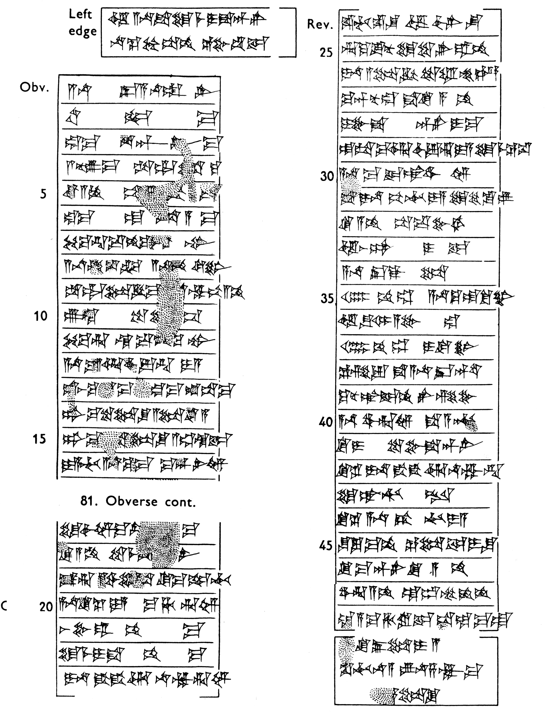

## Answers: Final

As before, don't worry about the equals signs. You can't know where to place them without a good understanding of the Hittite language. For the parts where you were asked to write in cuneiform, you might have used CVC signs where the original tablet didn't, or vice versa, and that's perfectly fine; what I'm transcribing here is exactly what was on the original, but there will often be other valid ways to write it.

### Preface

- _UMMA_ ^m^_Killa_ ^LÚ^SAŊŊA ^d^10 ^URU^_Nerik_
- _nepicac_ ^d^ICKUR-_ac_ ^EZEN~4~^_Purulliyac uttar_
- _nu mān kiccan taranzi_
- _utne=wa māu cecdu_
- _nu=wa utnē pahcanuwan ēcdu_
- [nu ma-a-an ma-a-i ce-ec-zi]{.signs}
- [nu EZEN₄^pu-ru-ul-li-ya-ac i-ya-an-zi]{.signs}

### The Storm-God's defeat

- _mān_ ^d^ICKUR-_ac_ ^MUC^_Illuyankac=ca_
- _INA_ ^URU^_Kickilucca arha tīēr_^[The original tablet actually says _arga_ instead of _arha_. One edition considers this a mistake for _arha tīēr_; another suggests that it's a mistake for a new verb _argatīēr_. Either way, _arga_ on its own isn't a known Hittite word.]
- _nu=za_ ^MUC^_Illuyankac_ ^d^ICKUR-_an tarahta_
- [d^ICKUR-ac-ta-ac-ca DIŊIR.MEC-na-ac hu-o-ma-an-du-uc mu-ú-ga-it]{.signs}
- _nu=za_ ^d^_Inarac_ EZEN~4~-_an iēt_
- _nu hōman mekki handait_
- ŊECTIN-_ac_ ^DUG^_palhi marnuwandac_ ^DUG^_palhi walhiyac_ ^DUG^_palhi_
- [nu DUG^pa-al-ha-ac an-da-an i-ya-da i-e-et]{.signs}

### Inara recruits Hopaciya

- _nu_ ^d^_Inarac INA_ ^URU^_Ziggaratta pait_
- _nu_ ^m^_Hōpaciyan_ LÚ.U~19~.LU _wemit_
- _UMMA_ ^d^_Inar_ ^m^_Hōpaciya_
- _kāca=wa kī=ya kī=ya uttar iyami_
- _nu=wa=mu=ccan ziqqa haraphut_
- _UMMA_ ^m^_Hōpaciya ANA_ ^d^_Inar_
- _mā=wa katti=ti cecmi, nu=wa uwami_
- _kardiac=tac iyami_
- _n=ac katti=ci cecta_

### The trap is laid

- _nu_ ^d^_Inarac_ ^m^_Hōpaciyan_ É-_ri pēhutet_
- [na-an mu-ú-un-na-a-it d-i-na-ra-ac-ca-az u-nu-ut-ta-at]{.signs}
- [na-ac-ta MUC-il-lu-ya-an-ka-an ha-at-te-ec-na-az ca-ra-a kal-li-ic-ta]{.signs}
- _kāca=wa=za_ EZEN~4~-_an iyami_
- _nu=wa adanna akuwanna ehu_
- _n=acta_ ^MUC^_Illuyankac QADU_ DUMU.MEC=_CU carā wēr_
- _nu=za eter ekuer_
- _n=acta_ ^DUG^_palha hōmanda ekuer_
- _n=e=za ninkēr_
- [ne na-am-ma ha-at-te-ec-na-ac kat-ta-an-da nu-o-ma-an pa-a-an-zi]{.signs}
- [m^hu-o-pa-ci-ya-ac-ca ú-it]{.signs}
- [nu MUC^il-lu-i-ya-an-ka-an ic-hi-ma-an-ta ka-le-e-li-e-et]{.signs}^[An extra plene spelling could be used here to show that this is _kaleliet_ rather than _kalelet_, but the scribe didn't do that.]
- ^d^ICKUR-_ac uit_
- _nu=kan_ ^MUC^_Illuyankan kuenta_
- DIŊIR.MEC-_ca katticci ēcer_^[This is actually _ēcer_, not \*\*_ēcr_—it's just an irregular spelling, since the verb root is _ēc-_ and the ending is _-er_.]

### Hopaciya's fate

- _nu=za=an_ ^d^_Inarac_ ^NA~4~^_peruni cer_ É-_ir wetet_
- _INA_ KUR ^URU^Tārukki^[Whether KUR, URU, both, or neither should be interpreted as logograms vs determinatives is an open question.]
- _nu_ ^m^_Hōpaciyan andan_ É-_ri acacta_
- [na-an d^i-na-ra-ac wa-tar-na-ah-hi-ic-ki-iz-zi]{.signs}
- _mā=wa gimra paimi_
- _zigga=war=acta_ ^ŊIC^_luttanza arha lē autti_
- _mā=war=acta arha=ma autti_
- _nu=wa=za_ DAM=_KA_ DUMU.MEC=_KA autti_
- _mān_ UD.20.KAM _pait_
- _apāc=a_ ^ŊIC^_luttan arha cuwaīt_
- _nu_ DAM=_SU_ DUMU.MEC=_CU aucta_
- (With _KA_ instead of _SU_, it would mean "your wife" instead of "his wife".)
- _mān_ ^d^_Inarac=ca gimraz_ EŊIR-_pa uit_
- _apac=ca wecgawan dāic_
- _āppa=wa=mu_ É-_na tarna_

### The end?

- _nu kāc apāc_ ^d^ICKUR-_ac_ ^MUC^_Illuyankac=ca memiac_

# Epilogue

## Acknowledgements

If you've gotten this far, I'd like to give a shout-out to Ryan Shosted, who got me into Hittite in the first place, and my sister Ada Stelzer, who reviewed the first version of this page and found all sorts of errors.

## Bonus: A little toy

Want to display your own cuneiform the way this page does? Type a transliteration in here.

<input type="text" id="writeyourown_in" size="32" /> <input type="button" value="Show" onclick="writeyourown_do();" />

:::{.signs #writeyourown_out}

:::
